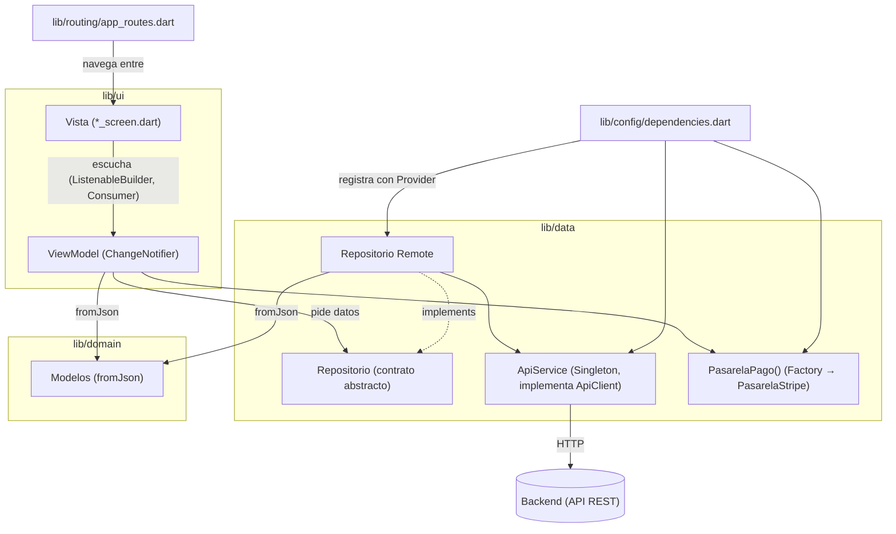

# Arquitectura de la app

Pier Repostería sigue la arquitectura **MVVM** de la
[guía oficial de Flutter](https://docs.flutter.dev/app-architecture): cada pantalla es
una vista que solo pinta y un ViewModel que guarda su estado; los datos llegan por
repositorios, y solo la capa de datos habla con el backend
(`PedroRubioo/pier-reposteria-backend`).

## Capas

| Carpeta | Capa | Qué contiene |
|---|---|---|
| `lib/ui` | Vistas y ViewModels | Una carpeta por función (`auth`, `products`, `cart`, `checkout`, `orders`, …) con `widgets/` (las pantallas `*_screen.dart` y sus widgets) y `view_model/` (un ViewModel por pantalla). `lib/ui/core` guarda el tema, los widgets compartidos y el estado global (`core/state`: sesión, carrito, tema, …). |
| `lib/data` | Repositorios y servicios | `repositories/`: 17 contratos abstractos (`*_repository.dart`) y sus implementaciones contra el backend (`*_repository_remote.dart`). `services/`: el cliente HTTP (`ApiClient` y `ApiService`), el almacenamiento local, las notificaciones y la pasarela de pago. Es la única capa que conoce el backend. |
| `lib/domain` | Modelos | `models/`: los datos de la app (producto, pedido, usuario, reseña, …), con su `fromJson`. No dependen de Flutter ni del backend. |
| `lib/config` y `lib/routing` | Configuración y navegación | `config/dependencies.dart` registra una sola vez el cliente, los repositorios y los providers globales; `api_constants.dart` (rutas del backend y ambientes), `monitoreo.dart` (Sentry) y `app_version.dart`. `routing/app_routes.dart` define las rutas con go_router y protege las que piden sesión. |
| `lib/utils` | Utilidades | `command.dart` (acciones con estado de carga y error, como el pago), validadores, formateadores y el logger. |

Ejemplo de punta a punta, el catálogo:
1. `ProductProvider` (`lib/ui/core/state/product_provider.dart`, estado global) pide la
   lista a `ProductosRepository`.
2. La implementación registrada, `ProductosRepositoryRemote`, hace `GET /productos` con
   el `ApiService`.
3. El provider convierte cada producto con `Product.fromJson`
   (`lib/domain/models/product_model.dart`) y avisa con `notifyListeners()`.
4. `ProductsScreen` (`lib/ui/products/widgets/products_screen.dart`) escucha a
   `ProductsViewModel` (`lib/ui/products/view_model/products_view_model.dart`). El
   ViewModel filtra esa lista y pide al mismo repositorio las categorías y los filtros.

## Patrones de diseño

| Patrón | Dónde está | Qué hace |
|---|---|---|
| **Singleton** | `lib/data/services/api_service.dart` | `ApiService` tiene un constructor privado (`ApiService._interno()`), la instancia única en `static final _instancia` y un `factory ApiService() => _instancia`: toda la app usa un solo cliente HTTP, que comparten los 17 repositorios. |
| **Factory** | `lib/data/services/pasarela_pago.dart` | `factory PasarelaPago() => PasarelaStripe()`: el checkout depende solo del contrato `PasarelaPago` y la fábrica decide la implementación concreta. `dependencies.dart` registra `PasarelaPago()`. Los modelos usan el mismo patrón para construirse desde JSON: 24 constructores `factory …fromJson` en `lib/domain/models`, como `Product.fromJson`. |
| **Repository** | `lib/data/repositories` | 17 contratos (`auth`, `carrito`, `comandas`, `configuracion`, `cuenta`, `demanda`, `direcciones`, `entregas`, `favoritos`, `notificaciones`, `pagos`, `pedidos`, `productos`, `publicaciones`, `quejas`, `reembolsos`, `resenas`), cada uno con su implementación `*Remote`, por ejemplo `ProductosRepository` y `ProductosRepositoryRemote`. Los ViewModels dependen del contrato; las pruebas usan la implementación con `FakeApiClient`. |
| **Observer** | `lib/ui/**/view_model/` y `lib/ui/core/state/` | 30 ViewModels extienden `ChangeNotifier` y avisan con `notifyListeners()`. Las vistas los escuchan: 43 archivos usan `ListenableBuilder` (por ejemplo `ProductsScreen` con `ProductsViewModel`); la insignia del carrito usa `Consumer<CartProvider>` (`lib/ui/main/widgets/main_screen.dart`), y cada pantalla escucha el tema con `context.watch<TemaProvider>()`. |

Además, `lib/config/dependencies.dart` hace la **inyección de dependencias** con
Provider: registra cada contrato con su implementación una sola vez, y las vistas y
ViewModels los piden con `context.read<XRepository>()`.

## Pruebas

| Carpeta | Qué prueba |
|---|---|
| `test/unitarias` | Caja blanca, sin red: validadores, providers, repositorios y ViewModels, una carpeta por épica. Los patrones de esta página se prueban en `test/unitarias/comun/patrones_test.dart`. |
| `test/widget` | Cada pantalla montada con el mismo árbol de dependencias que la app (`test/helpers/pump_app.dart`), una carpeta por pantalla. |
| `test/aceptacion` | Los escenarios Gherkin de las historias, automatizados como pruebas de widget. |
| `test/regresion` | Las pruebas de bugs ya corregidos; junto con las que llevan la etiqueta `regresion` (`dart_test.yaml`) forman la etapa de regresión del pipeline. |

Las pruebas sin red usan `test/fakes/fake_api_client.dart` en lugar del backend. Las
de `test/api` y `integration_test/` corren contra la API real o en el emulador. Cómo y
cuándo corre cada tipo está en la sección «Pruebas» del [README](../README.md#pruebas).
