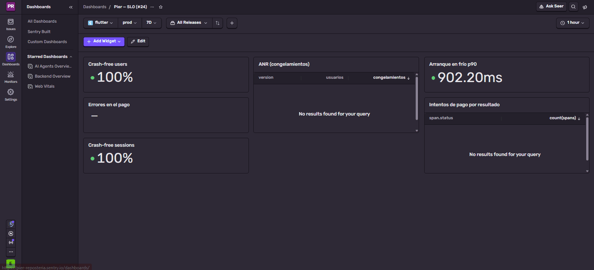
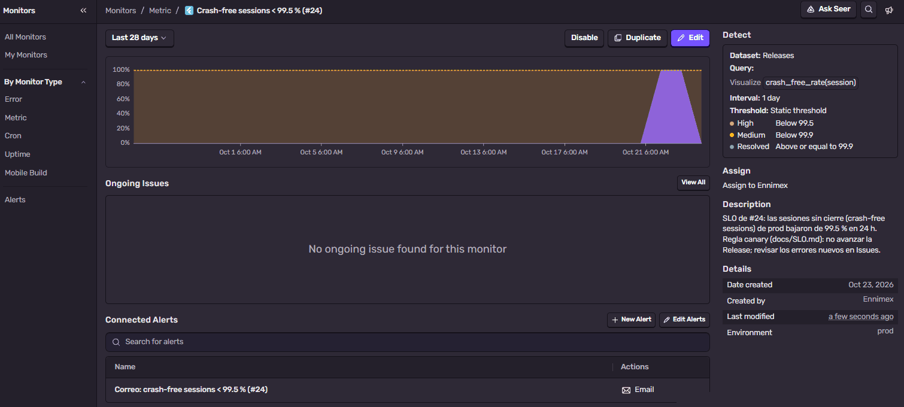
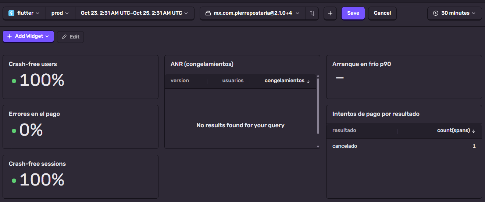
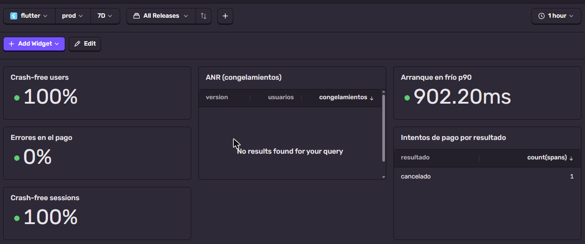

# Métricas y objetivos de servicio (SLO)

Con qué números se decide si una versión de la app sigue adelante o se
detiene. La estrategia canary completa (quién instala qué y cómo se sube a
Play) está en [LIBERACION.md](LIBERACION.md); aquí están las métricas, sus
objetivos y la regla de avance (#24).

## Las métricas

| Métrica | Qué dice | Fuente | Objetivo | Ventana | Responsable |
|---|---|---|---|---|---|
| **Crash-free sessions** | De cada 100 veces que se abre la app, cuántas terminan sin cerrarse de golpe | Sentry → Releases | **≥ 99.5 %** | 48 h por versión | Pedro |
| **Crash-free users** | De cada 100 personas, cuántas no vieron ningún cierre | Sentry → Releases | **≥ 99 %** | 48 h por versión | Pedro |
| **Tasa de ANR** | Sesiones en las que la app se congeló 5 s o más («la aplicación no responde») | Play Console → Android Vitals; mientras la app no esté en Play, Sentry | **< 0.47 %** (umbral de mal comportamiento de Google) | 28 días en Play; 48 h en Sentry | Pedro |
| **Arranque en frío p90** | El 90 % de las aperturas en frío muestran la primera pantalla en este tiempo o menos | Sentry → spans `app.start.cold` | **< 3 s** | 7 días | Alexander |
| **Errores en el pago** | De cada 100 intentos de pago, cuántos fallan por el servidor o la conexión | Sentry → spans `checkout.pagar` (etiqueta `flow:checkout`) | **< 1 %** de los intentos | 7 días | Alexander |

Línea base medida en el Samsung SM-N975U (#61): arranque en frío 1.6 s con el
servidor despierto.

### Cómo llega cada dato a Sentry

La app solo manda datos si el APK se compiló con `SENTRY_DSN` (los de
GitHub Releases lo traen; los de pruebas no). Cada evento lleva la versión
(`mx.com.pierreposteria@X.Y.Z+N`) y el ambiente (`prod`, `staging` o `dev`).

- **Sesiones y cierres**: los registra Sentry solo (`enableAutoSessionTracking`).
- **ANR**: el detector de Sentry para Android viene encendido (`anrEnabled`).
  Cuando la app esté en Play, la fuente oficial es Android Vitals.
- **Arranque en frío**: Sentry crea una transacción `ui.load` con un span
  `app.start.cold` en cada arranque muestreado (en el dataset Spans la medida
  se llama `app.vitals.start.cold.value`). Ojo: incluye la espera de
  `/pagos/config` antes del primer cuadro; si el servidor de Render está
  dormido, ese arranque sale de ~20 s.
- **Pago**: cada intento ya validado (con fecha, hora y dirección elegidas) es
  una transacción `pago` (op `checkout.pagar`) con las etiquetas
  `flow:checkout` y `resultado`
  ([`lib/config/monitoreo.dart`](../lib/config/monitoreo.dart)):

  | `resultado` | Cuándo | ¿Cuenta como error? |
  |---|---|---|
  | `pagado` | El pedido quedó registrado | No |
  | `cancelado` | El cliente cerró la hoja de pago o no aceptó el aviso de «por confirmar» | No |
  | `rechazado` | El banco rechazó la tarjeta | No |
  | `error` | Falló el servidor o la conexión al crear el cobro o al registrar el pedido | **Sí** (estado `internal_error`) |

  Las transacciones del pago se envían todas (100 %); las demás, el 20 % en
  prod para no agotar la cuota gratuita.

## Regla de avance del canary

Se revisa al terminar cada ventana de 48 h, con el filtro de la versión nueva:

| Crash-free sessions | Decisión |
|---|---|
| **≥ 99.5 %** y ningún objetivo de la tabla en rojo | Avanzar al siguiente paso: canary → 10 % → 50 % → 100 % |
| Entre 99 % y 99.5 % | Quedarse en el paso actual otras 48 h y revisar los errores nuevos |
| **< 99 %**, o un error grave nuevo | **Rollback**: detener el despliegue y publicar `vX.Y.Z+1` (pasos en [LIBERACION.md](LIBERACION.md#estrategia-canary)) |

Las demás métricas no detienen el avance por sí solas, salvo que estén en rojo
con datos suficientes (por ejemplo, el ANR por encima de 0.47 % o los errores
del pago por encima de 1 % con al menos 100 intentos).

## Dashboard en Sentry

Se arma una vez en sentry.io (proyecto `flutter`) → **Dashboards** →
**Create Dashboard** → nombre «Pier — SLO (#24)». Un widget por métrica, todos
con el filtro de ambiente `prod`:

| Widget | Dataset | Consulta | Visualización |
|---|---|---|---|
| Crash-free sessions | Releases | `crash_free_rate(session)` | Big Number |
| Crash-free users | Releases | `crash_free_rate(user)` | Big Number |
| ANR | Errors | `count_unique(user)` y `count()` por `release`, con `error.type:ApplicationNotResponding` | Table |
| Arranque en frío p90 | Spans | `p90(span.duration)` con `span.op:app.start.cold` | Big Number |
| Errores en el pago | Spans | `failure_rate()` con `is_transaction:true span.op:checkout.pagar` | Big Number |
| Intentos de pago por resultado | Spans | `count(spans)` por `resultado`, con `span.op:checkout.pagar` | Table |

Cómo se ve hoy la interfaz de Sentry (22-oct-2026):

- El dataset **Transactions** ya es obsoleto: las transacciones se consultan
  en **Spans** (cada transacción es su span raíz; `is_transaction:true` deja
  solo esas).
- Las tablas no tienen «Group by»: agrupan por las columnas de campo, como
  `release` o `resultado`.
- La etiqueta `resultado` no aparece en Sentry hasta que llega el primer pago
  que la trae (versiones posteriores a 2.0.0+3). Mientras tanto la tabla de
  intentos usa `span.status`; tras ese pago se cambia la columna a `resultado`.
- **Umbrales** de los widgets: los porcentajes se escriben en fracción
  (0.995 = 99.5 %; con 99.5 un 100 % sale en rojo) y de menor a mayor. En
  crash-free se marca *Higher is better*: rojo < 0.99, amarillo 0.99 a 0.995,
  verde ≥ 0.995. En tiempos y errores, *Lower is better* (arranque: verde
  < 2 s, rojo > 3 s).
- El plan Developer de Sentry permite 10 dashboards y 20 metric monitors.

El filtro **Release** guardado es *All Releases*. Para revisar una versión en
canary se elige esa versión sin guardar el cambio; si se guarda, el dashboard
se queda fijo en ella cuando salga la siguiente.

## Alerta

En Sentry la sección se llama **Monitors** (antes *Alerts*): el monitor crea
un issue cuando la métrica cruza el umbral y la alerta conectada manda el
correo. Monitor «Crash-free sessions < 99.5 % (#24)»: **Monitors** →
**Create Monitor** → *Metric*.

| Campo | Valor |
|---|---|
| Proyecto y ambiente | `flutter`, `prod` |
| Métrica | *Crash Free Session Rate* (dataset Releases, `crash_free_rate(session)`) |
| Intervalo | 1 day |
| Detección | *Threshold*: alta *Below* 99.5 %, media *Below* 99.9 % (aquí se escribe en porcentaje) |
| Se resuelve | *Default*: al volver a 99.9 % o más |
| Asignado | Ennimex |

Alerta conectada «Correo: crash-free sessions < 99.5 % (#24)»: se dispara con
*A new issue is created*, *An issue is resolved*, *An issue escalates* y
*A resolved issue regresses*; acción *Notify on preferred channel* →
*Suggested Assignees* (si no hay, *Recently Active Members*), que llega por
correo; *Get notified on every trigger*, porque solo avisa cuando el issue
cambia de estado. Como el monitor asigna sus issues a Ennimex, el respaldo
solo se usa si alguien quita esa asignación. Se probó con
*Send Test Notification* el 22-oct: el issue de prueba no tiene asignado, así
que el correo llegó por el respaldo.

El 99.5 % es el mismo número de la regla de avance, así que la alerta avisa
antes de la revisión de las 48 h. La alerta de errores de #23 (más de 10 en
1 hora) se queda como está.

## Revisiones del canary

### v2.1.0+4 — aprobada (24-oct-2026)

Canary en el Samsung SM-N975U con el APK de la
[Release v2.1.0](https://github.com/Ennimex/pier-reposteria-app/releases/tag/v2.1.0),
del 22-oct a las 20:31 al 24-oct a las 20:31 (hora de México). Dashboard con
`prod`, la versión `mx.com.pierreposteria@2.1.0+4` y esa ventana:

| Métrica | Valor | Objetivo | Resultado |
|---|---|---|---|
| Crash-free sessions | 100 % (13 sesiones, todas sanas) | ≥ 99.5 % | ✅ |
| Crash-free users | 100 % (1 usuario) | ≥ 99 % | ✅ |
| ANR | 0 congelamientos (0 %) | < 0.47 % | ✅ |
| Arranque en frío p90 | 902 ms en los 7 días de `prod` | < 3 s | ✅ |
| Errores en el pago | 0 % (1 intento, `cancelado`) | < 1 % | ✅ (pocos datos) |

- **Arranque:** la 2.1.0+4 no tiene ningún arranque en frío medido. De sus
  arranques, Sentry guardó 5 (muestreo del 20 %) y los 5 fueron en caliente
  (`app.start.warm`: la app seguía en memoria). Los 902 ms son de la ventana de
  7 días que fija la tabla, todos de la 2.0.0+3.
- **Pago:** con un solo intento el dato no basta para juzgar el objetivo (la
  regla pide al menos 100), pero no hubo errores.
- **Muestra chica:** un celular y una persona. Cuando haya canary con los
  dueños de Pier, la misma tabla tendrá más peso.

**Decisión:** *crash-free sessions* ≥ 99.5 % y ningún objetivo en rojo →
avanzar. La app todavía no está en Play, así que el siguiente paso (10 % en
Play Console) espera a la primera subida; mientras tanto, la v2.1.0 queda como
la versión estable.

