# Pruebas de aceptación — Producción y comandas en el celular (#131)

Comprobamos en un teléfono real, con cuentas reales de hornos, decoración y
dirección, el ciclo completo de una comanda entre la web y la app: se captura
en la web, producción la lee y confirma de enterado en el celular, la web la
edita, producción vuelve a confirmar, y al final se entrega y se cancela desde
el celular. Cubre las historias #126, #127, #128 y #129.

## Datos de la prueba

| Dato | Valor |
|---|---|
| Fecha | Jueves 22 de octubre de 2026 a las 23:19 a viernes 23 a las 00:08 (hora de México) |
| Dispositivo | Samsung Galaxy Note10+ (SM-N975U), Android 12 |
| App | **Pier** de la Release [v2.1.0](https://github.com/Ennimex/pier-reposteria-app/releases/tag/v2.1.0) (`mx.com.pierreposteria`, 2.1.0+4), el APK firmado que publica `release.yml` |
| Web y servidor | Los de producción (`pier-reposteria-backend.onrender.com`) |
| Cuentas | Hornos y decoración (cuentas del equipo que aparecen en Usuarios y roles de la web; entran con Google) y dirección general. No hay cuenta de empleado: ver el escenario 6 |
| Comandas de prueba | **#5001** «PRUEBA 131 A - no preparar», para el 23-oct a las 12:00 (se entrega) y **#5002** «PRUEBA 131 B - no preparar», para el 3-nov (se cancela). Las dos con un pastel personalizado de $300 y $250 y anticipo del 20 % |
| Cómo se verificó | Capturas del celular con `adb exec-out screencap` y capturas de la web. Los toques de «Enterado», «Entregar» y «Cancelar» se hicieron desde la laptop con `adb shell input` |

## Resumen

| # | Escenario | Historia | Resultado |
|:-:|---|:-:|:-:|
| 1 | Hornos y decoración entran a Comandas, nunca a la tienda | #126 | ✅ Pasó |
| 2 | Las comandas capturadas en la web aparecen en la agenda con su color de urgencia | #127 | ✅ Pasó |
| 3 | «Enterado» de hornos y de decoración; la firma se ve en la web; ningún monto visible | #128 | ✅ Pasó |
| 4 | Editar la comanda en la web después de la firma: el celular muestra el cambio y pide volver a firmar | #128 | ✅ Pasó |
| 5 | Desactivar la cuenta de decoración: la app cierra la sesión | #126 | ✅ Pasó |
| 6 | Entregar y cancelar desde el celular; la web lo refleja | #129 | ✅ Pasó, con la cuenta de dirección |

No hubo fallas, así que no se abrió ningún issue `bug`.

## 1. Hornos y decoración entran a Comandas

En el celular se cerró la sesión de cliente y se entró con Google con la cuenta
de hornos; después, igual, con la de decoración.

**Resultado:** ✅ cada cuenta abre directo su agenda, «Comandas · Hornos» y
«Comandas · Decoración», sin la barra de la tienda (Inicio, Catálogo, Carrito).
El menú ⋮ solo ofrece «Abrir panel web» y «Cerrar sesión».

| Hornos | Decoración |
|:-:|:-:|
| 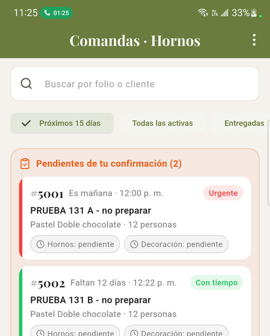 | 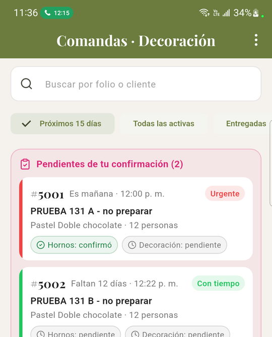 |

## 2. Las comandas de la web llegan a la agenda con su color

1. En la web, con la cuenta de dirección, se capturaron #5001 (23:19, entrega
   al día siguiente) y #5002 (23:23, entrega en 12 días).
2. Se abrió la agenda en el celular.

**Resultado:** ✅ las dos aparecen en «Pendientes de tu confirmación (2)» y en
su día, con el mismo color que en la web: #5001 en rojo «Urgente» («Es
mañana») y #5002 en verde «Con tiempo» («Faltan 12 días»).

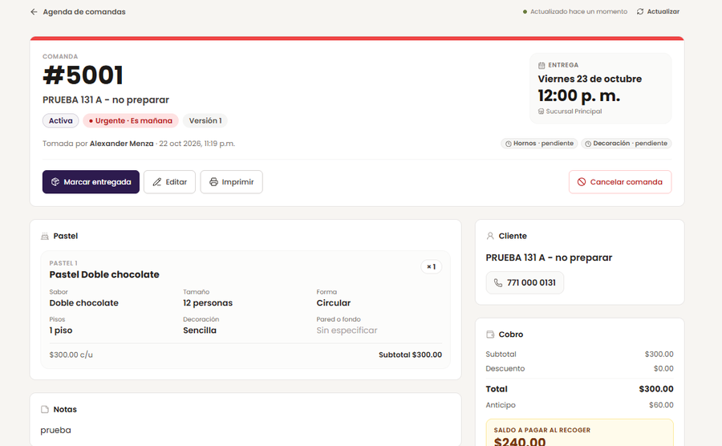

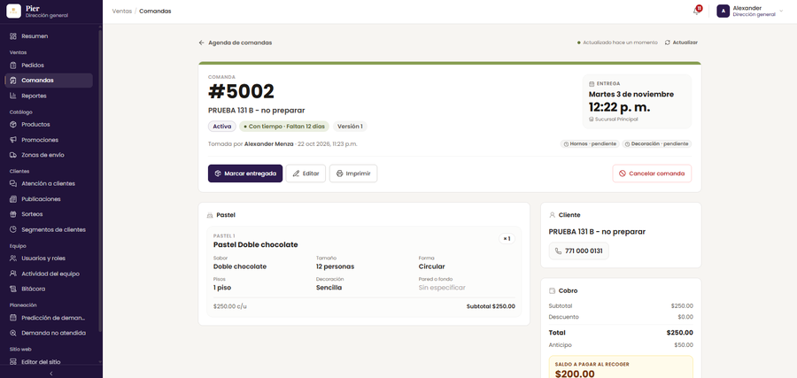

## 3. «Enterado» de hornos y de decoración, sin montos

1. Con hornos, se abrió #5001 y se recorrió el detalle completo.
2. Se tocó «Enterado» y se confirmó en el diálogo.
3. Lo mismo con decoración.
4. En la web se actualizó la comanda.

**Resultado:** ✅

- **Ningún monto visible:** el detalle de hornos y el de decoración muestran el
  pastel, las notas, el cliente y la confirmación de producción, pero no la
  sección de cobro. En la web la misma comanda dice total $300, anticipo $60 y
  saldo $240. La lista de la agenda tampoco muestra montos.
- El diálogo pide confirmar la versión exacta: «Confirmo que leí la comanda
  #5001 (versión 1). Esta acción no se puede deshacer».
- Después de confirmar, la app dice «Enterado registrado» y la comanda queda
  con «Hornos: confirmó · versión 1» y quién firmó.
- **La firma se ve en la web:** «Confirmó la versión 1», con nombre y hora:
  hornos a las 11:26 p. m. y decoración a las 11:36 p. m.

| Detalle sin montos | Confirmar | Enterado registrado |
|:-:|:-:|:-:|
| 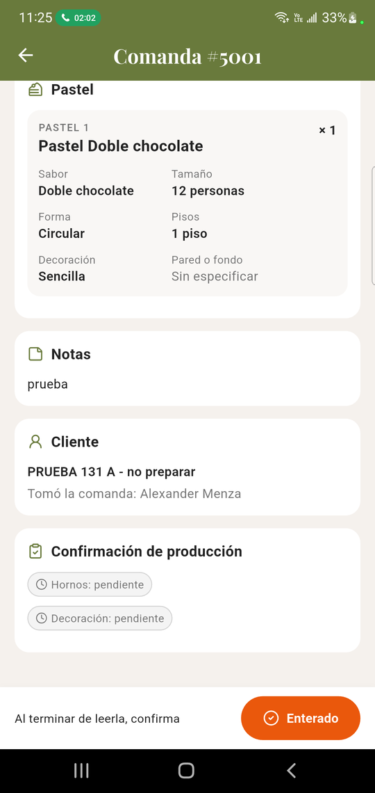 | 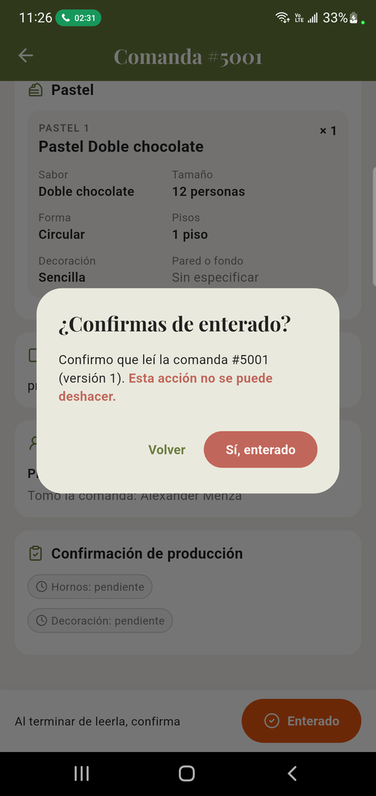 | 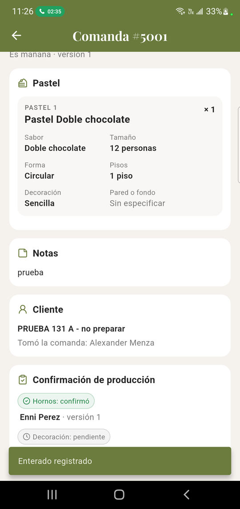 |

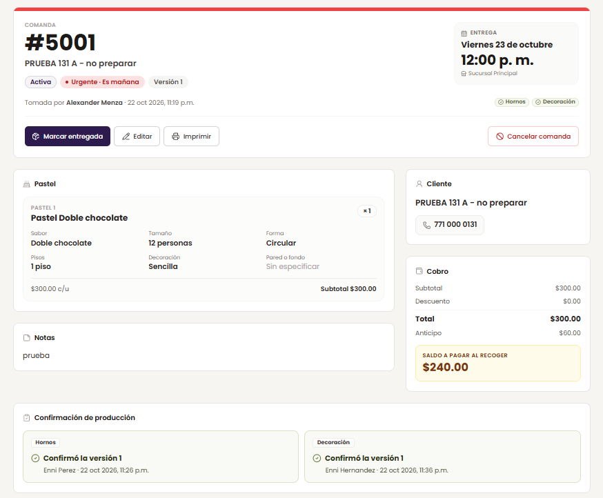

## 4. Editar en la web después de la firma

1. En la web se editó #5001: la hora de entrega pasó de 12:00 a 13:00 y la
   comanda quedó en la versión 2 (00:01).
2. En el celular, con decoración, se actualizó la agenda y se abrió #5001.
3. Decoración volvió a confirmar.

**Resultado:** ✅

- En la agenda, #5001 regresó a «Pendientes de tu confirmación» con «Hornos:
  falta re-confirmar» y «Decoración: falta re-confirmar».
- El detalle avisa arriba «Qué cambió desde tu última confirmación: Tu área
  confirmó la versión 1; ahora va en la versión 2» y muestra el cambio, «Hora
  de entrega: 12:00 → 13:00». Abajo dice «Cambió: revisa los cambios y vuelve a
  confirmar».
- El diálogo de la versión 2 repite el cambio que se está confirmando.
- Después de confirmar, decoración queda en «confirmó · versión 2» y hornos
  sigue en «falta re-confirmar · versión 1», porque hornos aún no lo había
  visto.

| Qué cambió | Confirmar la versión 2 | Decoración firmó la versión 2 |
|:-:|:-:|:-:|
| 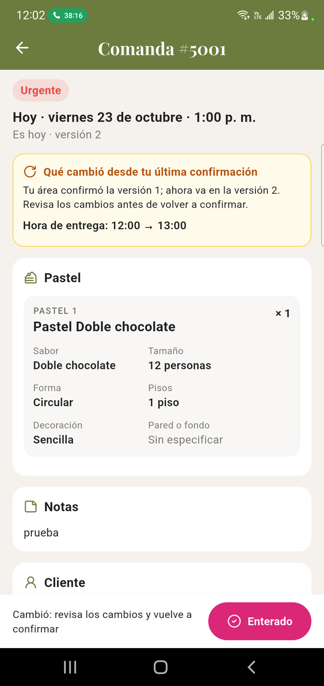 | 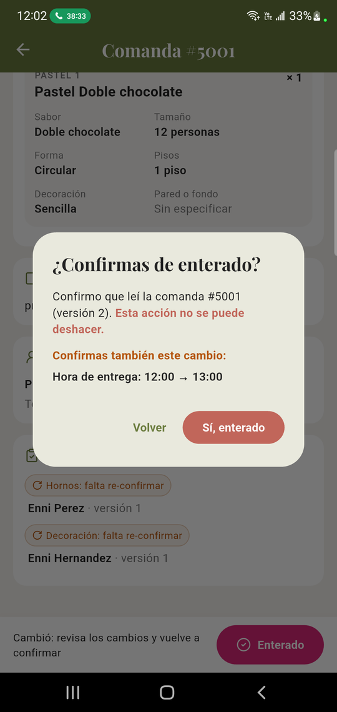 | 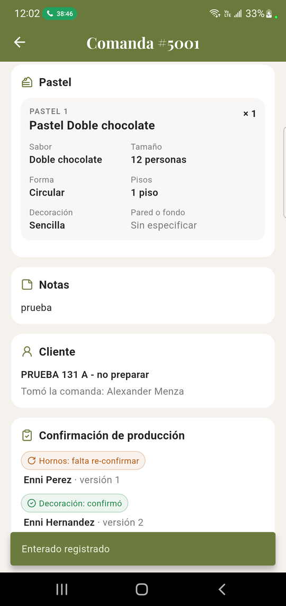 |

## 5. Desactivar la cuenta cierra la sesión

1. Con decoración en la agenda del celular, en la web (Usuarios y roles) se
   desactivó la cuenta de decoración.
2. En el celular se actualizó la agenda (00:04).
3. En la web se reactivó la cuenta.

**Resultado:** ✅ al actualizar, la app regresó sola a la pantalla de inicio de
sesión: el servidor rechaza las peticiones de una cuenta desactivada con
`codigo: 'SESION_INVALIDA'` y la app cierra la sesión al recibirlo.

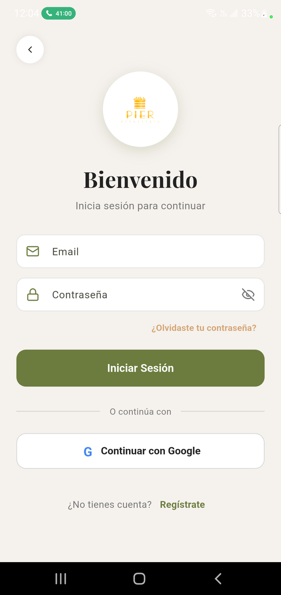

## 6. Entregar y cancelar desde el celular

**Cambio respecto al plan:** no había cuenta de empleado, así que este
escenario se hizo con la cuenta de **dirección general**, que también trabaja
en la agenda del celular. Qué botones aparecen lo decide el servidor con los
permisos de cada comanda: entregar lo pueden hacer empleado, gerencia y
dirección; cancelar, quien tomó la comanda, gerencia y dirección. Por eso el
flujo en la app es el mismo. Lo que no se comprobó es la regla propia del
empleado: que solo pueda cancelar las comandas que él tomó.

1. Se entró con dirección: la agenda se llama «Comandas» y, a diferencia de
   hornos y decoración, **sí muestra montos** («Total $300.00 · Saldo
   $240.00»).
2. En #5001 se tocó «Entregar».
3. En #5002 se tocó «Cancelar comanda» y se escribió el motivo «Prueba de
   aceptacion 131».
4. En la web se revisaron las pestañas «Entregadas» y «Canceladas».

**Resultado:** ✅

- **Entregar:** el diálogo trae el saldo pendiente ya escrito ($240.00, total
  $300 menos anticipo $60) y avisa «Producción aún no confirma la versión
  actual: falta Hornos. Puedes entregarla de todos modos». Avisa, pero no
  bloquea. Al confirmar dice «Comanda #5001 entregada. Hornos no confirmó de
  enterado la versión 2», y el detalle queda con «Saldo cobrado $240.00» y
  quién entregó, sin los botones.
- **Cancelar:** pide un motivo de 5 a 300 caracteres y avisa que producción
  recibirá el aviso. Al confirmar dice «Comanda #5002 cancelada» y el detalle
  muestra «Comanda cancelada: Prueba de aceptacion 131».
- **La web lo refleja:** #5001 aparece en «Entregadas» («entregada a las
  12:07 a. m.») y #5002 en «Canceladas» («cancelada a las 12:08 a. m.»). Ya no
  aparecen en «Próximos 15 días».

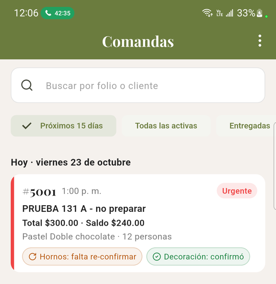

| Entregar | Entregada | Cancelar | Cancelada |
|:-:|:-:|:-:|:-:|
| 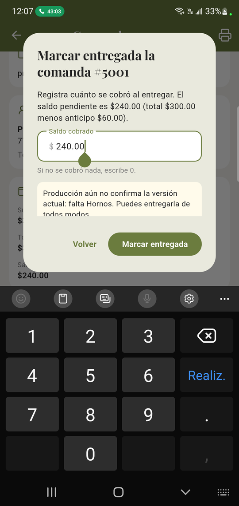 | 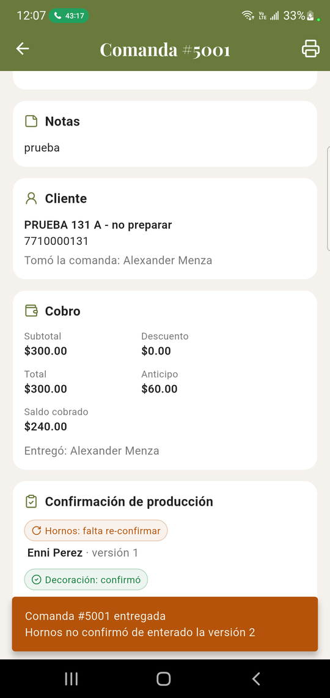 | 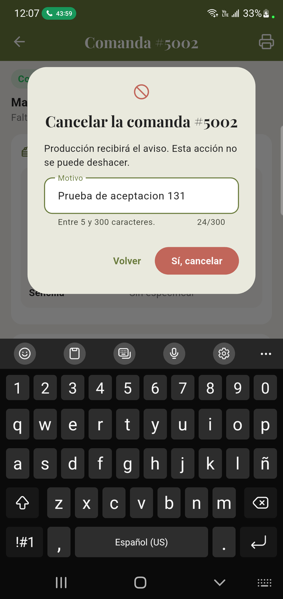 | 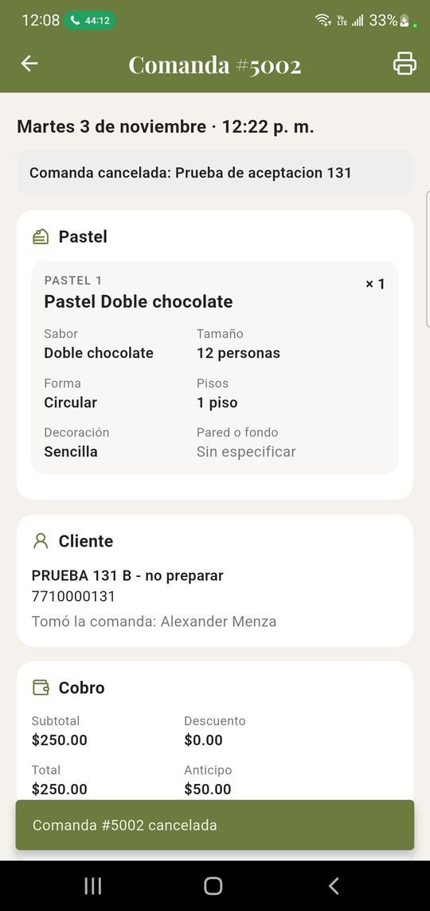 |

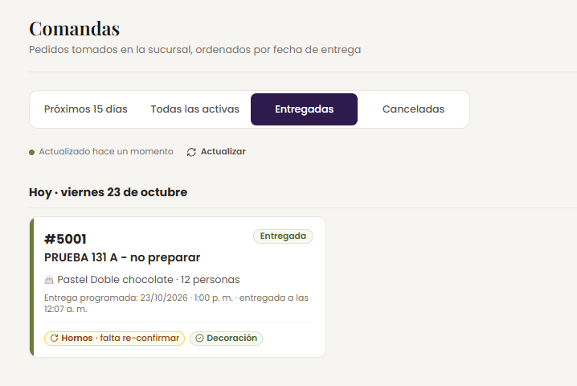

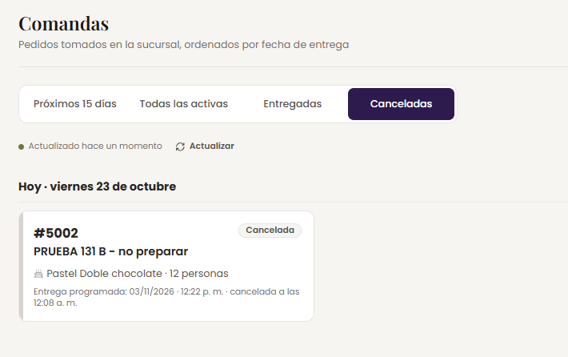

## Observaciones

- **Cambio de día a medianoche:** a las 00:00 y 00:01 del reloj del celular,
  la agenda todavía decía «Mañana · viernes 23» y «Faltan 12 días». Un minuto
  después ya decía «Hoy» y «Faltan 11 días». El servidor calcula el día con
  `NOW() AT TIME ZONE 'America/Mexico_City'`, así que fue la diferencia de
  reloj entre el celular y el servidor justo al cambiar de día. No es una
  falla.
- La comanda #5000, que estaba en la agenda, no es de esta prueba y no se tocó.
  Las capturas se recortaron para no mostrarla.

## Cómo repetir estas pruebas

1. En la web, con una cuenta de dirección o gerencia, capturar dos comandas de
   prueba con un pastel personalizado: una para mañana y otra para dentro de
   más de 7 días.
2. En el celular, con el APK de la Release (`mx.com.pierreposteria`), entrar
   con Google con la cuenta de hornos, revisar la agenda y el detalle, y
   confirmar de enterado la primera comanda. Repetir con decoración.
3. Editar la primera comanda en la web (por ejemplo, la hora) y revisar en el
   celular que pida volver a confirmar.
4. Desactivar la cuenta de decoración en Usuarios y roles con su sesión
   abierta en el celular, actualizar la agenda y reactivarla.
5. Entrar con una cuenta de empleado, gerencia o dirección, entregar la
   primera comanda y cancelar la segunda.

```bash
adb exec-out screencap -p > captura.png      # captura de pantalla
adb shell input tap <x> <y>                  # tocar un botón desde la laptop
adb shell input text "Motivo%sde%sprueba"    # escribir en el campo enfocado (%s = espacio)
```
