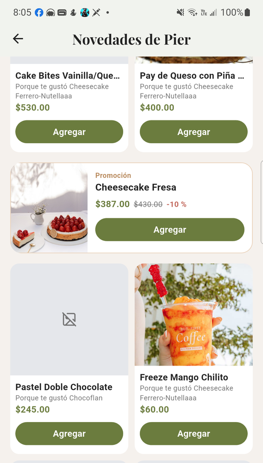
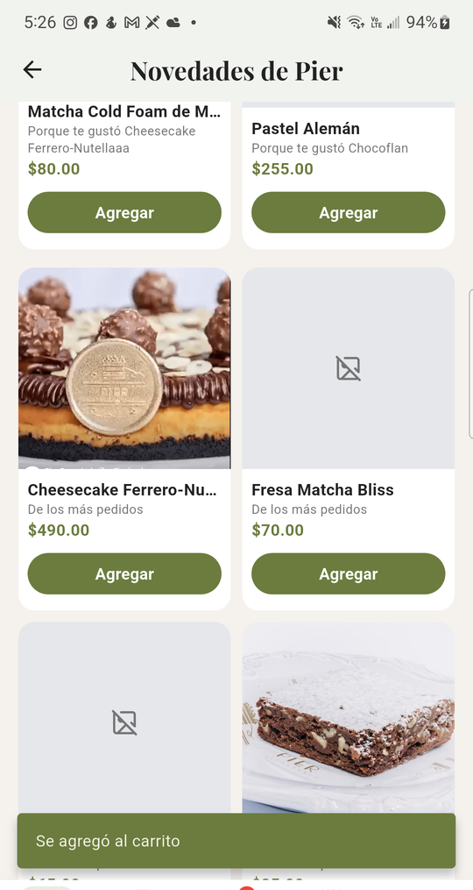
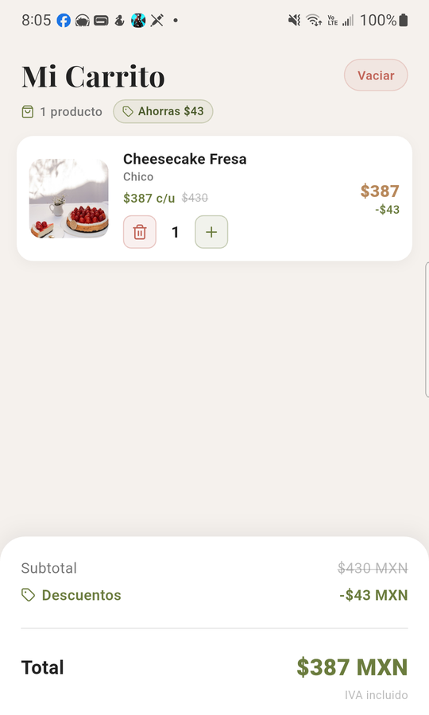
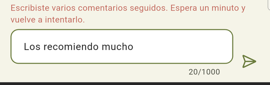
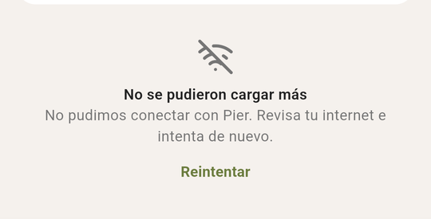

# Pruebas de aceptación — Publicaciones del cliente en el celular (#135)

Comprobamos en un teléfono real, con lo que se publicó desde la web, que las
publicaciones del inicio funcionan de punta a punta. Se revisaron el feed por
páginas con sus promociones y sugerencias, «Me encanta», los comentarios y la
respuesta oficial, los videos, quién no debe verlas y qué pasa sin red. Cubre
las historias #132, #133 y #134.

## Datos de la prueba

| Dato | Valor |
|---|---|
| Fecha | Sábado 31 de octubre de 2026, de 16:20 a 20:20 (hora de México), en varios tramos |
| Dispositivo | Samsung Galaxy Note10+ (SM-N975U), Android 12, con Wi-Fi y datos móviles |
| App | **Pier STAGING** (`mx.com.pierreposteria.staging`, 2.1.1+5, debug), compilada de `develop` (`623a76f`) con los PR #255 a #263 juntos (`7d0b889`). Para la promoción y el repartidor se usó **Pier DEV** (`mx.com.pierreposteria.dev`) con el arreglo del PR #278, después de encontrar la falla #277 |
| Web y servidor | Los de producción (`pier-reposteria-backend.onrender.com`) |
| Cuentas | La cuenta de cliente de pruebas, una de repartidor y, en la web, una del personal para responder y crear la oferta |
| Datos de prueba | 4 publicaciones de Pier Repostería con fotos y videos, una oferta relámpago de Cheesecake Fresa con 10 %, 5 comentarios del cliente y una respuesta oficial |
| Cómo se verificó | Toques y textos con `adb shell input`, capturas con `adb exec-out screencap`, el árbol de la pantalla con `uiautomator dump` y las peticiones con `adb logcat -s flutter`. La red se cortó con `adb shell svc wifi disable` y `svc data disable` |

## Resumen

| # | Escenario | Historia | Resultado |
|:-:|---|:-:|:-:|
| 1 | Una publicación con foto creada desde la web aparece en el inicio | #132 | ✅ Pasó |
| 2 | Desplazamiento largo: páginas sin repetir, promociones intercaladas y sugerencias al final | #132 | ✅ Pasó con el arreglo de #277 |
| 3 | Agregar al carrito desde una promoción y desde una sugerencia | #132 | ✅ Pasó; la promoción, con el arreglo de #277 |
| 4 | «Me encanta» y comentario desde el teléfono; respuesta oficial de la web en el teléfono | #133 | ✅ Pasó |
| 5 | Sexto comentario en un minuto: aviso de espera | #133 | ✅ Pasó |
| 6 | Video: arranca en silencio al verse y se pausa al salir | #134 | ✅ Pasó |
| 7 | Invitado y repartidor no ven publicaciones ni mensajes de error | #132 | ✅ Pasó |
| 8 | Sin red a mitad del desplazamiento: mensaje claro y reintento, sin cierre | #132 | ✅ Pasó |

Se abrió un issue `bug`, **#277**. Con una promoción activa, Novedades se quedaba
cargando. Lo arregla el PR #278, y los escenarios 2 y 3 se repitieron con ese
arreglo.

## 1. Una publicación de la web en el inicio

Con la sesión de cliente, el Inicio muestra primero las publicaciones de Pier
Repostería que se crearon en la web, con su texto, su fecha y sus fotos. Al
final de la sección está «Ver todo», que lleva a Novedades.

**Resultado:** ✅


## 2. Desplazamiento largo

En Novedades se bajó hasta el final. Hay 4 publicaciones, así que caben en la
primera página (`GET /publicaciones/feed?limite=8`, sin cursor siguiente).
Siguieron las sugerencias de «Te podría gustar», con dos páginas
(`/publicaciones/sugerencias?pagina=1` y `2`). Al final apareció «Ya viste todo
por hoy».

**Resultado:** ✅
- Las 4 publicaciones salieron una sola vez.
- La promoción salió después del primer bloque de 6 sugerencias, que es la
  regla cuando hay menos de 5 publicaciones.
- El paso a una segunda página de publicaciones no se pudo ver en el teléfono,
  porque hay menos de 8. Lo cubren las pruebas unitarias del feed.

**Falla encontrada (#277).** Después de crear la oferta relámpago en la web, al
jalar para refrescar, `GET /publicaciones/promociones` respondió 200, pero la
app lanzó `type 'String' is not a subtype of type 'num?'` en `PromocionFeed`.
El servidor manda el descuento como texto (`"10.00"`). Novedades se quedó con
lo que tenía y un indicador de carga al final, sin la promoción, las sugerencias
ni más páginas. Con el arreglo del PR #278, el feed carga y la promoción sale
como se esperaba.



## 3. Agregar al carrito desde una sugerencia y desde una promoción

- **Sugerencia:** «Agregar» en Matcha Cold Foam de Mango mostró «Se agregó al
  carrito» (`POST /carrito` → 201). Después se quitó del carrito
  (`DELETE /carrito/…` → 200).
- **Promoción** (con el arreglo de #277): «Agregar» en la tarjeta «Promoción ·
  Cheesecake Fresa · $387.00, antes $430.00, −10 %» respondió `POST /carrito`
  → 201. El carrito cobra $387, con «Ahorras $43» y un total de $387 MXN.
  Después se quitó.

**Resultado:** ✅

| Sugerencia agregada | Promoción en el carrito |
|:-:|:-:|
|  |  |

## 4. «Me encanta», comentarios y respuesta oficial

Desde el teléfono se marcó «Me encanta» en una publicación y se escribieron 5
comentarios (`POST /publicaciones/5/comentarios` → 201). En la web, el personal
vio los comentarios y respondió como Pier. Al abrir otra vez los comentarios en
el teléfono, la respuesta salió al final con la marca «Respuesta de Pier».

**Resultado:** ✅


## 5. Sexto comentario en un minuto

Después de los 5 comentarios se escribió un sexto en el mismo minuto. El
servidor respondió 429 y la app mostró «Escribiste varios comentarios seguidos.
Espera un minuto y vuelve a intentarlo.». El texto se quedó en el campo para
volver a intentarlo.

**Resultado:** ✅



## 6. Videos

Al llegar a una publicación con video, este arrancó solo y en silencio (botón
«Activar sonido»). Se compararon dos capturas tomadas con un segundo de
diferencia. Con el video a la vista cambió del 25 al 49 % de los píxeles. Con
el video casi fuera de la pantalla, la misma medición dio 0 %: estaba en pausa.
No se midieron los tirones con herramientas de rendimiento. A simple vista, el
desplazamiento fue fluido.

**Resultado:** ✅


## 7. Invitado y repartidor

- **Invitado:** sin sesión, el Inicio no muestra publicaciones ni mensajes de
  error.
- **Repartidor:** con su cuenta, la app abre directo «Mis entregas», con las
  pestañas Entregas, Historial y Perfil. Desde el inicio de sesión solo pidió
  `/entregas/disponibilidad`, `/entregas/disponibles` y `/entregas/mis-entregas`,
  ninguna de `/publicaciones`, y no hubo errores. No se tomó ninguna entrega ni
  se cambió la disponibilidad. La captura no se incluye porque muestra el
  nombre y la dirección de un cliente.

**Resultado:** ✅

## 8. Sin red a mitad del desplazamiento

Con Novedades a medio recorrer se apagaron el Wi-Fi y los datos. Se usó
`svc wifi` y `svc data` en lugar del modo avión, para no tocar el Bluetooth del
teléfono. La app no se cerró:
- **Al seguir bajando:** al final salió «No se pudieron cargar más», con el
  texto «No pudimos conectar con Pier. Revisa tu internet e intenta de nuevo.»
  y «Reintentar».
- **Al jalar para refrescar sin red:** las publicaciones que ya se veían se
  quedaron.
- **Con la red de vuelta:** «Reintentar» cargó las sugerencias
  (`/publicaciones/sugerencias` → 200).

**Resultado:** ✅



## Cómo quedó todo

- Los 5 comentarios del cliente se quedaron publicados; son positivos.
- El carrito quedó vacío.
- Se cerraron las sesiones del repartidor y del cliente en Pier DEV.
- El Wi-Fi y los datos quedaron encendidos.
- La oferta relámpago de prueba se crea y se quita desde la web.

## Cómo repetir estas pruebas

1. En la web, con una cuenta del personal, publicar al menos una publicación
   con foto y otra con video, y crear una oferta relámpago de un producto.
2. En el celular, con la cuenta de cliente, recorrer Novedades hasta «Ya viste
   todo por hoy». Agregar al carrito desde una sugerencia y desde la
   promoción, y quitarlos. Comentar 6 veces en menos de un minuto.
3. Responder uno de los comentarios desde la web y revisarlo en el celular.
4. Cerrar la sesión y revisar el Inicio como invitado. Entrar con una cuenta
   de repartidor.

```bash
adb shell svc wifi disable            # apagar el Wi-Fi (enable para encenderlo)
adb shell svc data disable            # apagar los datos móviles
adb logcat -d -v time -s flutter      # ver las peticiones de la app
```
