# Pruebas en dispositivo — Sprint 2 (#78)

Comprobamos en un teléfono real que el flujo de compra aguanta lo que pasa en un celular: una llamada, una notificación, mandar la app a segundo plano, que Android la cierre para liberar memoria y que se caiga la red. Cubre las historias #34 (inicio de sesión), #35 (carrito) y #36 (checkout).

## Datos de la prueba

| Dato | Valor |
|---|---|
| Fecha | Sábado 17 de octubre de 2026, de 13:36 a 13:54 (hora de México) |
| Dispositivo | Samsung Galaxy Note10+ (SM-N975U), Android 12, conectado por Wi-Fi y sin datos móviles |
| App | **Pier DEV** (`mx.com.pierreposteria.dev`, versión 1.1.0), compilada el 14-oct. El código de la app (`lib/`) es idéntico al de `main` desde `4ed75d2` |
| Servidor | El real (`pier-reposteria-backend.onrender.com`), con una cuenta de cliente |
| Cómo se provocó cada situación | Comandos `adb` desde la laptop conectada por USB; las capturas son de `adb exec-out screencap` |
| Cómo se verificó | Las capturas y el registro de la app (`adb logcat -s flutter`) |

## Resumen

| # | Escenario | Resultado |
|:-:|---|:-:|
| 1 | Llamada entrante a mitad del checkout (con un sustituto, ver abajo) | ✅ Pasó |
| 2 | Notificación con el carrito abierto | ✅ Pasó |
| 3 | 30 s en segundo plano con la hoja de pago de Stripe abierta | ✅ Pasó |
| 4 | Android cierra la app con ella en segundo plano | ✅ Pasó |
| 5 | Se cae la red al cargar el catálogo y al pagar | ⚠️ Pasó con una falla de mensaje: **#160** |

## 1. Llamada entrante a mitad del checkout

**Cambio respecto al plan:** no había otro celular para hacer la llamada. En su lugar se usó un **temporizador del Reloj** que suena a los 5 segundos. Para la app es la misma interrupción: otra aplicación se pone encima a pantalla completa y la app queda detrás, como al contestar una llamada.

1. En el checkout se eligió «Recoger», la fecha 18/10/2026 y la hora de 09:00 a 10:00.
2. Desde la laptop se lanzó el temporizador: `adb shell am start -a android.intent.action.SET_TIMER --ei android.intent.extra.alarm.LENGTH 5 --ez android.intent.extra.alarm.SKIP_UI true`.
3. Al sonar apareció como ventana emergente, igual que una llamada con el celular en uso. Se tocó para abrir el Reloj a pantalla completa (13:54:30), se esperaron unos 10 s y se regresó a la app desde recientes.

**Resultado:** ✅ el checkout conserva todo lo capturado: entrega, sucursal, fecha, hora y el total de $490. La app siguió en el mismo proceso, sin reiniciarse.

| Antes | Temporizador encima | Después |
|:-:|:-:|:-:|
| 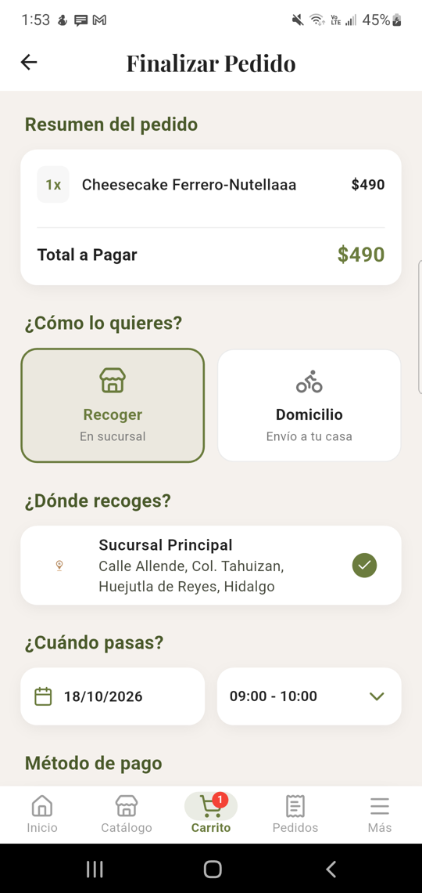 | 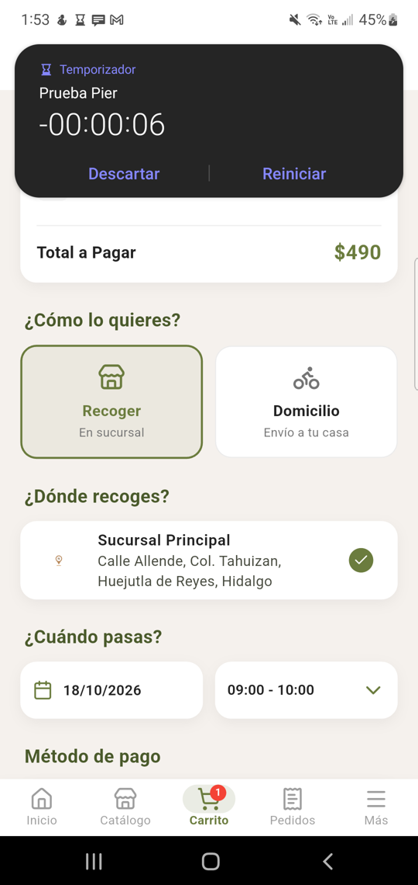 | 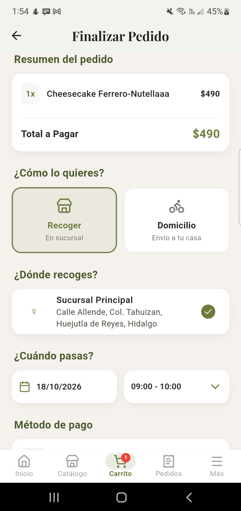 |

## 2. Notificación con el carrito abierto

1. Con 1 producto en el carrito (Cheesecake Ferrero-Nutellaaa, $490) se envió una notificación: `adb shell cmd notification post -t "Pier" prueba "Tu pedido va en camino"`.
2. Se abrió el panel de notificaciones de Android, se vio la notificación y se cerró el panel.

**Resultado:** ✅ la notificación no interrumpe la app y al regresar el carrito sigue igual.

Nota: el texto de la notificación llegó cortado («Tu») porque `adb shell` separa las palabras entre comillas; es un detalle del comando de prueba, no de la app.

| Antes | Notificación | Después |
|:-:|:-:|:-:|
| 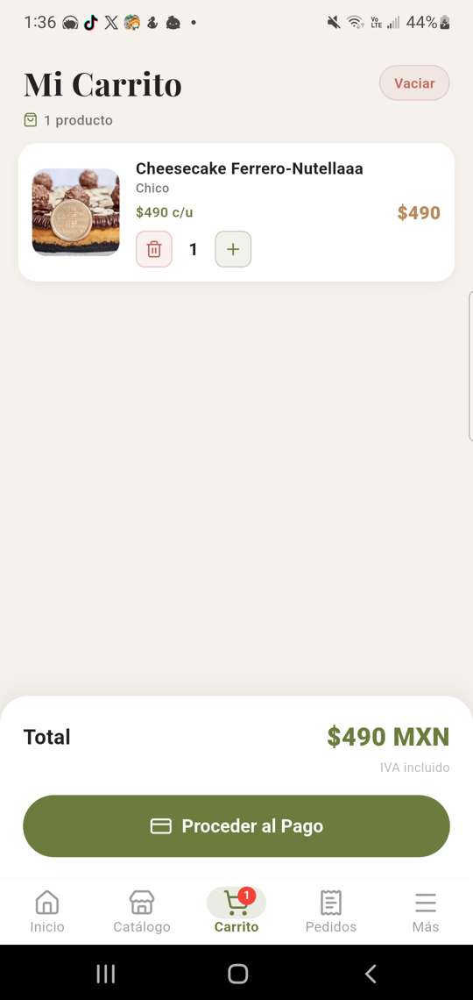 | 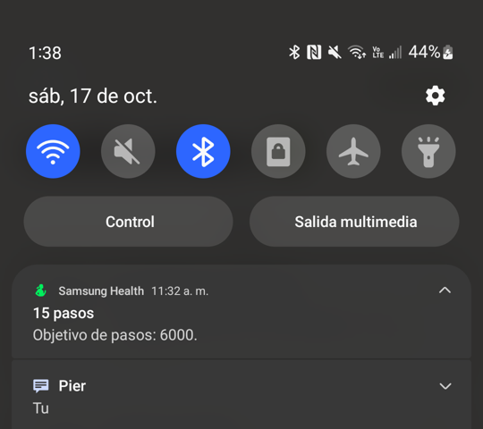 |  |

## 3. Segundo plano con la hoja de pago abierta

1. En el checkout se tocó «Pagar» y se llenó la hoja de Stripe (modo TEST) con la tarjeta de prueba 4242 4242 4242 4242, **sin pagar**.
2. Desde la laptop se mandó el celular a la pantalla de inicio (`adb shell input keyevent KEYCODE_HOME`, 13:41:53) y se esperaron 30 s.
3. Se regresó a la app desde recientes.

**Resultado:** ✅ la hoja de pago sigue abierta **con todos los datos llenos** (tarjeta, fecha, CVC y código postal); solo reaparece el teclado porque el cursor estaba en el código postal. No hubo peticiones nuevas al servidor ni errores. El plan pedía que la hoja se pudiera reabrir o que el checkout siguiera visible; se cumplió de sobra.

| Antes | Al regresar |
|:-:|:-:|
| 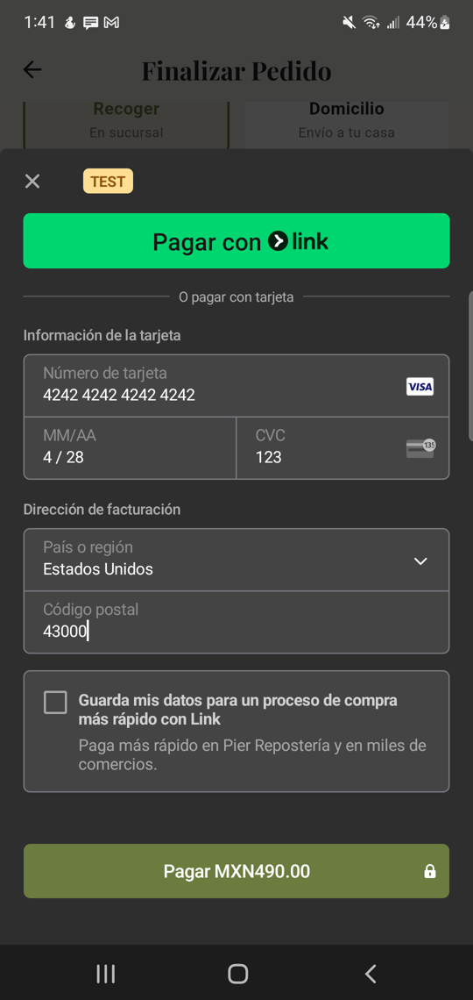 | 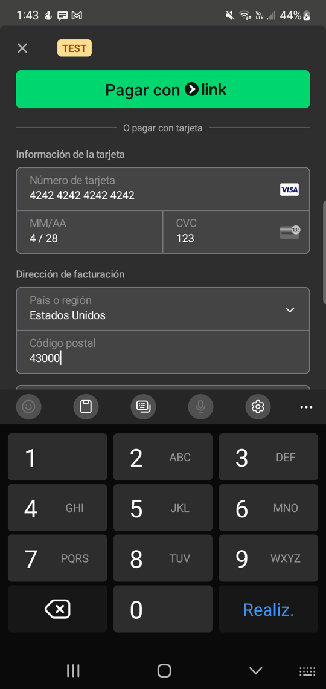 |

## 4. Android cierra la app para liberar memoria

1. Con el carrito abierto, se mandó la app a segundo plano y se cerró su proceso como lo hace Android cuando le falta memoria: `adb shell am kill mx.com.pierreposteria.dev`. El proceso 31287 desapareció.
2. Se volvió a abrir la app desde recientes.

**Resultado:** ✅ la app arrancó como proceso nuevo (12476), **conservó la sesión** sin pedir la contraseña (`redirect loc=/splash isAuth=true` → `/main`) y **recargó el carrito desde el servidor** (`GET /carrito` → 200): el mismo producto y el mismo total.

| Antes | Tras reabrir |
|:-:|:-:|
| 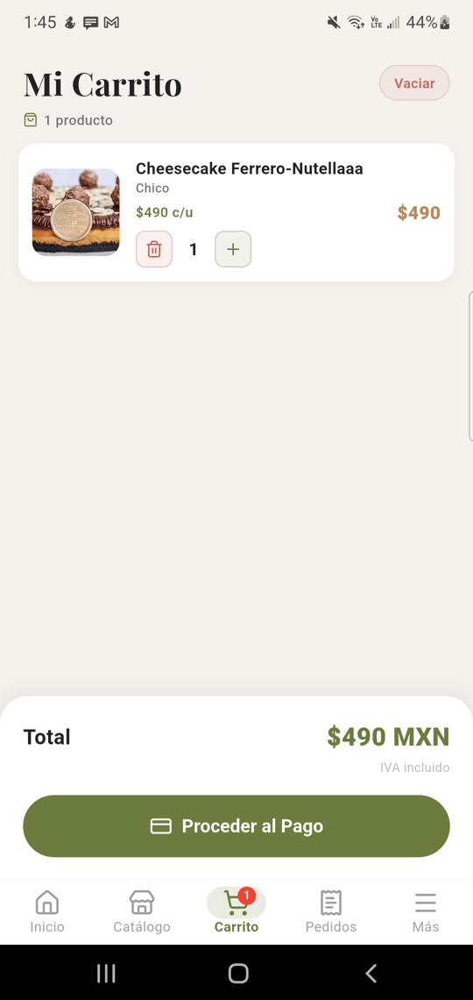 | 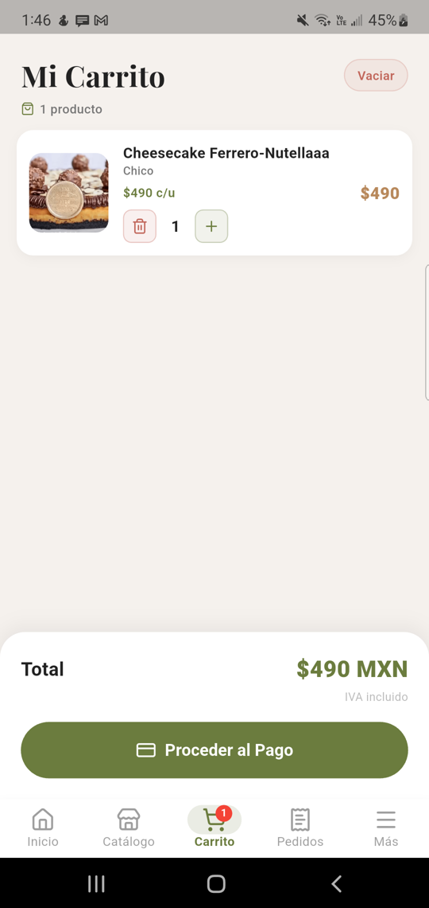 |

## 5. Se cae la red

El celular no tenía datos móviles, así que al apagar el Wi-Fi se quedaba **sin internet**: el caso más exigente.

| Paso | Cómo | Resultado |
|---|---|:-:|
| Recargar el catálogo sin red | `adb shell svc wifi disable` y deslizar el catálogo para recargar | ⚠️ La app no se cierra, pero muestra «Sin resultados / Limpiar filtros» en lugar de avisar que no hay conexión y ofrecer reintentar. **Falla registrada en #160** |
| Volver a tener red | `adb shell svc wifi enable` y recargar | ✅ Cargan los productos |
| Pagar sin red | `adb shell cmd connectivity airplane-mode enable` (modo avión) y tocar «Pagar» | ✅ Mensaje claro: «No pudimos conectar con Pier. Revisa tu internet e intenta de nuevo.» El botón «Pagar» queda para reintentar |
| Reintentar el pago con red | Quitar el modo avión tras más de 10 s y tocar «Pagar» otra vez | ✅ Se abre la hoja de Stripe (`/pagos/crear-intent` → 200); se cerró sin pagar |

En ningún momento la app se cerró ni mostró texto técnico (la corrección de #112 funciona).

| Catálogo sin red ⚠️ | Catálogo con red | Pagar sin red | Reintento |
|:-:|:-:|:-:|:-:|
| 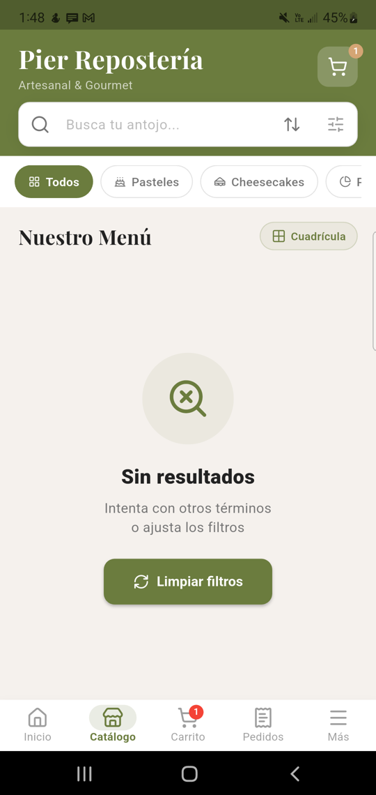 | 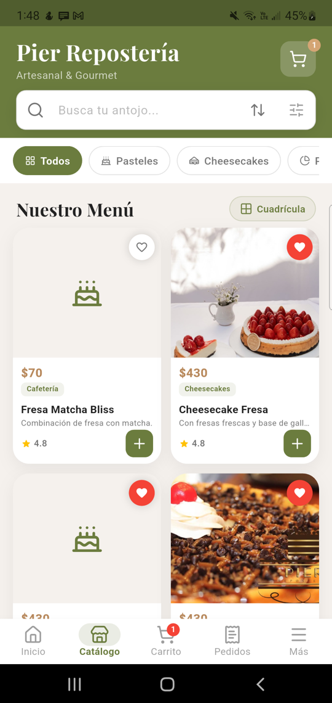 | 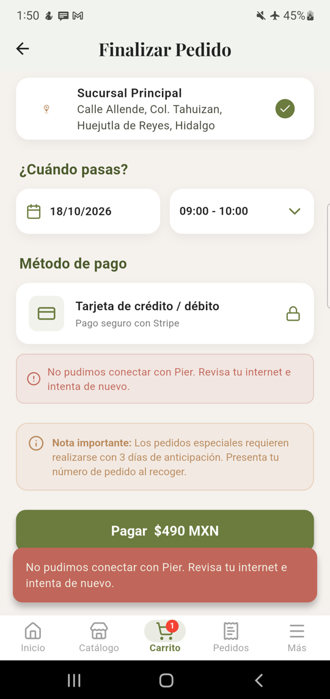 | 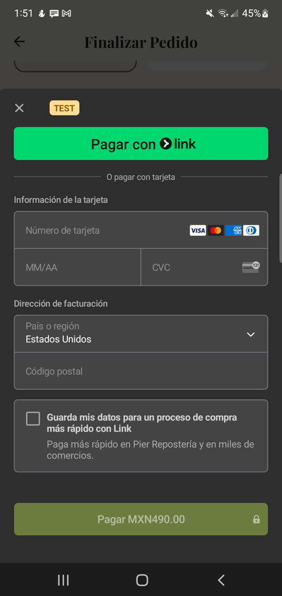 |

## Fallas encontradas

| Issue | Falla |
|---|---|
| #160 | Sin conexión, el catálogo dice «Sin resultados / Limpiar filtros» en vez de avisar que no hay conexión y ofrecer «Reintentar» |

## Cómo repetir estas pruebas

Con el celular conectado por USB y la depuración USB activada:

```bash
adb devices                                                     # el celular debe aparecer como «device»
adb shell cmd notification post -t "Pier" prueba "Tu pedido va en camino"   # notificación
adb shell input keyevent KEYCODE_HOME                           # mandar la app a segundo plano
adb shell am kill mx.com.pierreposteria.dev                     # Android cierra la app (debe estar en segundo plano)
adb shell svc wifi disable                                      # apagar el Wi-Fi (svc wifi enable para prenderlo)
adb shell cmd connectivity airplane-mode enable                 # modo avión (disable para quitarlo)
adb logcat -d -v time -s flutter                                # registro de la app
adb exec-out screencap -p > captura.png                         # captura de pantalla
```

Para la versión de producción, el paquete es `mx.com.pierreposteria`, sin `.dev`.
