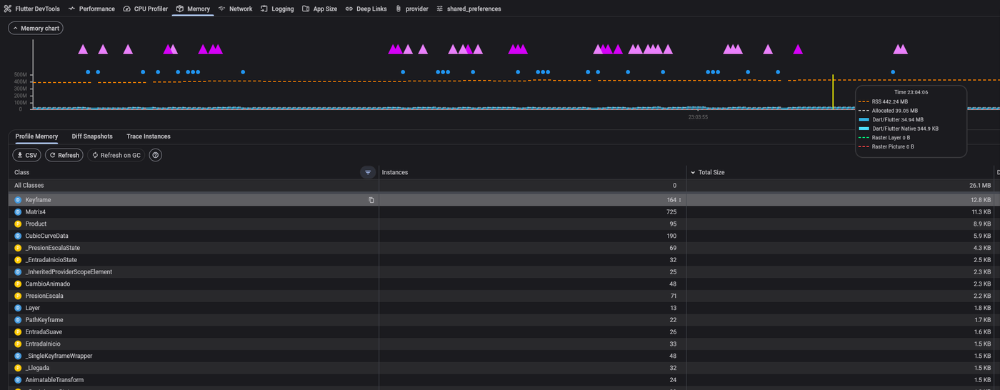

# Pruebas en dispositivo — Sprint 3 (#79)

Medimos cuánta memoria, CPU y batería consume la app en un teléfono real con el
APK de release, y si sigue funcionando con la batería baja y el ahorro de
energía activado. Los valores quedan junto a la línea base de rendimiento de
#61 y se repiten en #71 con la versión candidata.

## Datos de la prueba

| Dato | Valor |
|---|---|
| Fecha | Jueves 22 de octubre de 2026, de 20:51 a 21:08 (hora de México) |
| Dispositivo | Samsung Galaxy Note10+ (SM-N975U), Android 12, conectado por Wi-Fi |
| App | **Pier** de la Release [v2.1.0](https://github.com/Ennimex/pier-reposteria-app/releases/tag/v2.1.0) (`mx.com.pierreposteria`, 2.1.0+4), el APK firmado que publica `release.yml` |
| Servidor | El real (`pier-reposteria-backend.onrender.com`), con una cuenta de cliente |
| Cómo se midió | Comandos `adb` desde la laptop conectada por USB: `dumpsys meminfo`, `top` y `dumpsys batterystats`. No se instaló nada en la app |

## Resumen

| # | Medición | Resultado | Umbral |
|:-:|---|---|:-:|
| 1 | Memoria al abrir, tras 5 min en el catálogo y al volver del segundo plano | 285 → 307 → 267 MB (PSS); sube y baja con las fotos, sin crecer sin parar. En el APK de profile, con Flutter DevTools, el heap de Dart vuelve a 24-25 MB después de cada recolección | ✅ Estable |
| 2 | CPU en reposo, navegando y en segundo plano | Reposo ~3 %, navegando 28 % de promedio, segundo plano 0 a 2 % | ✅ Cerca de 0 % en reposo |
| 3 | Batería en 9 min 32 s de uso normal | 4.51 mAh (≈ 0.7 % de la batería por hora, sin contar la pantalla); sin wakelocks propios | ✅ |
| 4 | Batería al 5 % con ahorro de energía | Catálogo y checkout funcionan | ✅ |

## 1. Memoria

`adb shell dumpsys meminfo mx.com.pierreposteria`, en kB redondeados a MB. PSS
es la memoria que el sistema le cuenta a la app (la compartida se reparte entre
quienes la usan).

| Momento | Hora | PSS total | Gráficos | Nativa | Java | Código |
|---|:-:|--:|--:|--:|--:|--:|
| Al abrir (arranque en frío, Inicio) | 20:51 | 285 MB | 117 MB | 54 MB | 9 MB | 60 MB |
| Tras 5 min navegando el catálogo | 20:58 | 307 MB | 148 MB | 60 MB | 7 MB | 52 MB |
| Tras 1 min en segundo plano | 21:00 | 273 MB | 99 MB | 69 MB | 6 MB | 52 MB |
| Al volver del segundo plano | 21:00 | 267 MB | 95 MB | 73 MB | 7 MB | 52 MB |
| Tras usar carrito y checkout | 21:03 | 284 MB | 109 MB | 72 MB | 9 MB | 52 MB |

Durante los 5 min del catálogo se tomó el PSS cada 30 s: **297, 278, 292, 251,
265, 265, 270, 269, 281, 275 y 310 MB**. Sube al cargar fotos nuevas y baja
cuando se liberan; no hay una subida continua. La mayor parte son gráficos (las
imágenes del catálogo y el carrusel). En segundo plano la app soltó 49 MB de
gráficos.

### Comparación con Flutter DevTools (APK de profile)

DevTools solo se conecta a una app compilada en *debug* o *profile*: el APK de
release no deja abierta la VM de Dart. Por eso se repitió el recorrido con
**Pier DEV en profile**, el mismo día de 22:49 a 23:05, en el mismo celular,
contra el servidor real y con la misma cuenta de cliente.

| Dato | Valor |
|---|---|
| App | Pier DEV (`mx.com.pierreposteria.dev`), `flutter run --profile --flavor dev` con `API_BASE_URL` del servidor real |
| Código | `main` en `df223e6`: frente a la v2.1.0 solo cambia el botón del checkout de #188 |
| Herramientas | Flutter 3.47.0 y DevTools 2.60.0 |
| Cómo se midió | En cada momento, `dumpsys meminfo mx.com.pierreposteria.dev` y, por el VM service (la fuente de la gráfica de DevTools), el heap de Dart antes y después de forzar una recolección (`getAllocationProfile` con `gc: true`, lo mismo que el botón *GC* de DevTools). Al final se abrió la vista **Memory** de DevTools conectada a la app |

| Momento | Hora | PSS release | PSS profile | Gráficos | Código | Heap de Dart | Heap de Dart tras GC |
|---|:-:|--:|--:|--:|--:|--:|--:|
| Al abrir (Inicio) | 22:49 | 285 MB | 338 MB | 105 MB | 96 MB | 27.4 MB | 24.0 MB |
| Tras 5 min navegando el catálogo | 22:55 | 307 MB | 405 MB | 148 MB | 90 MB | 33.9 MB | 24.8 MB |
| Tras 1 min en segundo plano | 22:56 | 273 MB | 367 MB | 113 MB | 90 MB | — | — |
| Al volver del segundo plano | 22:57 | 267 MB | 335 MB | 82 MB | 90 MB | 31.1 MB | 24.3 MB |
| Tras usar carrito y checkout | 22:58 | 284 MB | 342 MB | 88 MB | 90 MB | 27.4 MB | 25.4 MB |
| Tras 1½ min más en el catálogo, con DevTools abierto | 23:05 | — | 381 MB | 118 MB | 86 MB | 28.3 MB | 25.1 MB |

Gráficos y código son del APK de profile. La memoria *external* de Dart (la
que Dart reserva fuera de su heap) no pasó de 0.8 MB en ningún momento.

Durante los 5 min del catálogo se tomaron cada 30 s el PSS y el heap de Dart:
PSS **333, 334, 371, 380, 386, 392, 394, 398, 403, 402 y 403 MB**; heap de Dart
**27.2, 25.2, 30.0, 28.4, 28.7, 31.2, 28.2, 29.2, 31.2, 26.3 y 24.7 MB**.

En la gráfica de DevTools, tomada a las 23:04:06 después de 1½ min en el
catálogo, se ven **RSS 442 MB, Dart/Flutter 34.9 MB y Allocated 39.1 MB**. Los
triángulos morados son recolecciones de basura.

**Comparación:**

- **Las dos herramientas cuentan lo mismo.** El RSS de DevTools (442 MB) cae en
  el rango del `TOTAL RSS` de `dumpsys` en profile (440 a 510 MB), y su
  Dart/Flutter (34.9 MB) es del mismo orden que el heap de Dart leído de la VM
  antes de cada recolección (24.7 a 33.9 MB).
- **El heap de Dart es una parte chica de la memoria**: entre el 7 y el 9 % del
  PSS en cada medición. El resto son los gráficos (las fotos ya
  decodificadas viven en el motor de Flutter, no en el heap de Dart) y el
  código.
- **Dart no retiene memoria.** Después de cada recolección el heap regresa a
  24-25 MB: 24.0 MB al abrir, 24.8 MB tras 5 min, 24.3 MB al volver, 25.4 MB
  tras el checkout y 25.1 MB al final. Lo que sube al navegar es basura que el
  recolector libera, como se ve en la serie de 30 s.
- **Profile pesa más que release**, entre 50 y 100 MB de PSS: casi 40 MB son de
  código (86-96 MB contra 52-60 MB), porque el profile carga lo que DevTools
  necesita para perfilar. En release el PSS del catálogo subía y bajaba entre
  251 y 310 MB. En profile subió de 333 a unos 403 MB en los primeros 4 min y
  ahí se quedó. En los dos casos no crece sin parar y baja en segundo plano.
- **En segundo plano Samsung congela la app** unos 70 s después de salir: salió
  a las 22:55:28, Android la marcó inactiva a las 22:56:29 y quedó congelada a
  las 22:56:39 (logcat: `FreecessController … Frozen, Reason: uidIdle`). Congelada, no
  responde a la VM: DevTools pierde la conexión y por eso esa fila no tiene
  heap de Dart. Esto coincide con el 0-2 % de CPU del release. Al volver,
  Android la trajo al frente en **128 ms** (*HOT*, mismo proceso; en release
  fueron 108 ms).

## 2. CPU

`adb shell top -b -n 1 -p <pid> -o PID,%CPU,RES`. `top` cuenta 100 % por cada
núcleo, así que 50 % es medio núcleo.

| Momento | Muestras | Resultado |
|---|:-:|---|
| Reposo en Inicio, recién abierta | 5 (1 por segundo) | 3.4, 2.0, 6.0, 42.0 y 1.0 % (mediana 3.4 %). El pico coincide con el cambio automático del carrusel |
| Navegando el catálogo (scroll, productos y categorías) | 64 (cada 4 s, 5½ min) | Promedio 28 %, mediana 31 %, p90 52 %, máximo 79 %; 14 muestras en 0 % (pausas) |
| En segundo plano | 5 (1 por segundo) | 0.0, 0.0, 2.0, 1.0 y 0.0 % |

Al volver del segundo plano Android la trajo al frente en **108 ms** (`am start
-W`: *HOT*), en el mismo proceso: no la había cerrado.

## 3. Batería

1. `adb shell dumpsys battery unplug`: el celular siguió conectado por USB, pero
   Android cuenta el consumo como si estuviera desconectado.
2. `adb shell dumpsys batterystats --reset` a las 20:53.
3. Uso normal: 5½ min en el catálogo, 1 min en segundo plano y unos 3 min en
   carrito y checkout (sin pagar).
4. `adb shell dumpsys batterystats --charged mx.com.pierreposteria` a las 21:03.

| Dato | Valor |
|---|---|
| Tiempo medido | 9 min 32 s con batería, 9 min con la pantalla encendida |
| Consumo estimado de Pier | **4.51 mAh**: CPU 4.48, servicios del sistema 0.01, Wi-Fi 0.02 |
| Por hora | ≈ 28 mAh, cerca del 0.7 % de la batería de 4,170 mAh |
| Wakelocks de la app | Ninguno: no mantiene el celular despierto |

Android no le asigna la pantalla a ninguna app, así que esos 4.51 mAh no la
incluyen. Pier fue la app que más consumió en ese rato porque era la que estaba
en uso.

## 4. Batería baja y ahorro de energía

1. `adb shell dumpsys battery set level 5` (con el `unplug` del paso anterior).
2. `adb shell settings put global low_power 1` (estaba en `0`).
3. En la app: catálogo, abrir un producto, agregarlo al carrito y llegar al
   checkout eligiendo fecha y hora.
4. `adb shell dumpsys battery reset` y `adb shell settings put global low_power 0`
   al terminar. El celular volvió a su 27 % real, cargando por USB.

**Resultado:** ✅ el catálogo cargó productos y fotos con el scroll fluido, y en
el checkout se pudieron elegir fecha y hora. La prueba fue después de las 21:00,
así que el botón decía «Fuera de servicio» y no dejaba pagar: es la regla del
horario de atención (`checkout_screen.dart`: fuera de horario no se crean
pedidos), no un efecto de la batería.

**Observación:** con la tienda cerrada, el aviso del checkout dice «Puedes
dejar tu pedido y lo prepararemos en horario de atención», pero el botón no
deja hacer el pedido. El texto promete algo que la app no permite. Se
abrió **#188**: la app deja pagar el pedido programado, como la web.
