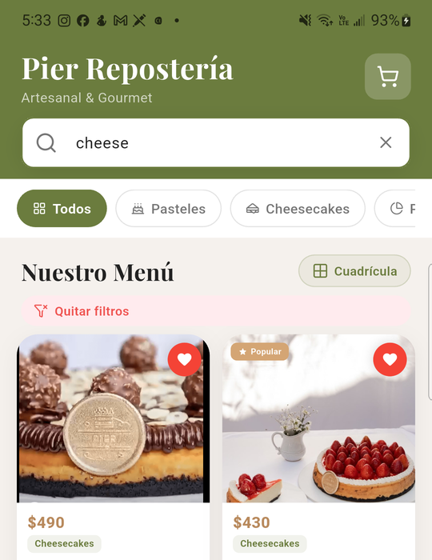
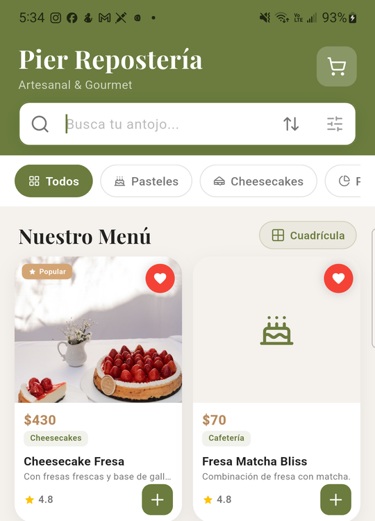
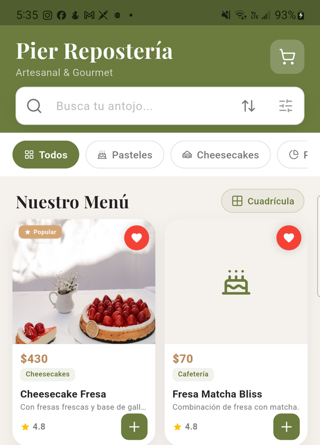
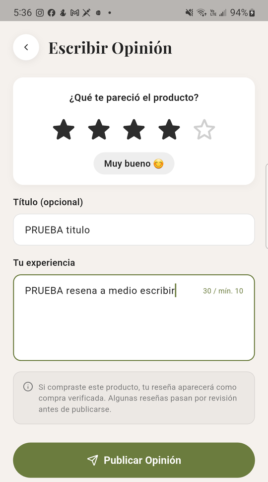
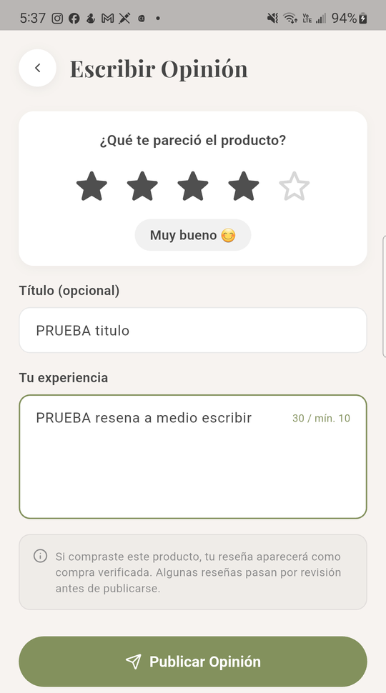
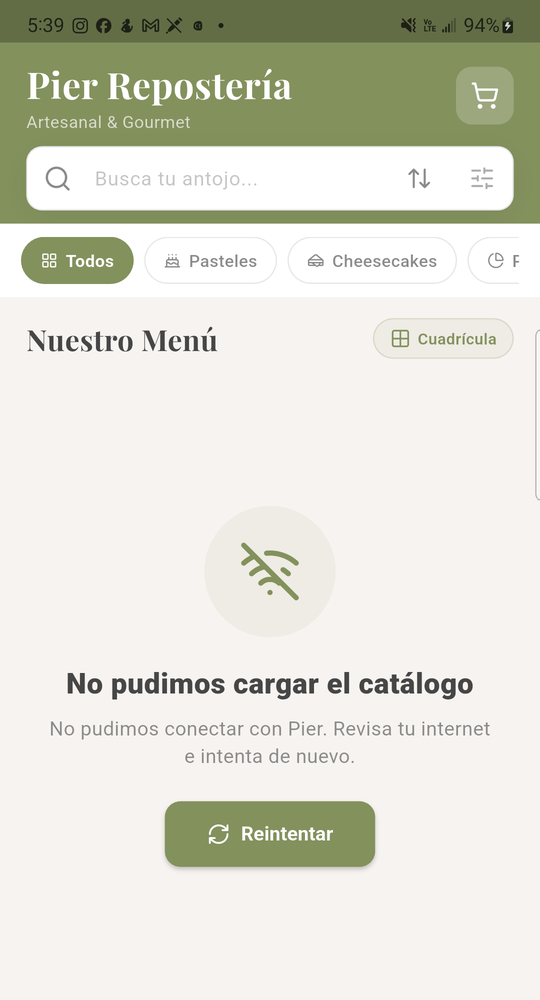
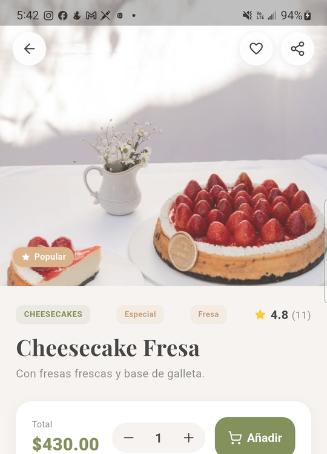
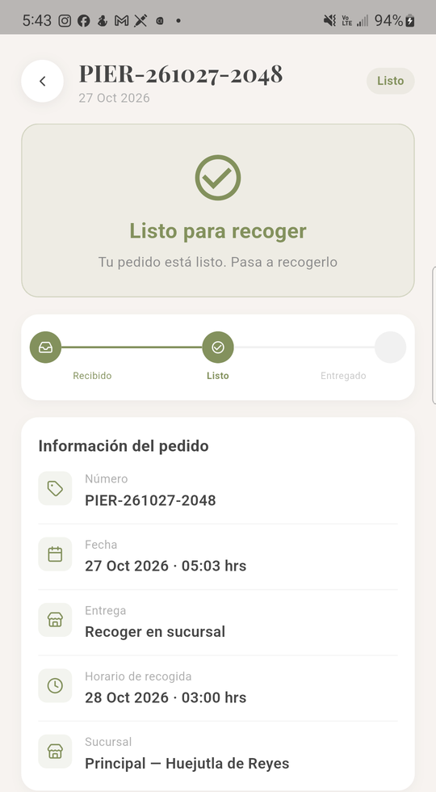

# Pruebas en dispositivo — Persistencia y red en catálogo, pedidos y reseñas (#80)

Comprobamos en un teléfono real que la búsqueda, los favoritos, las reseñas y
los pedidos conservan su estado cuando la app pasa a segundo plano o se cierra
su proceso. También revisamos cómo se comportan el catálogo y los pedidos al
cambiar de red o quedarse sin ella. Cubre las historias #37 a #42 y complementa
las pruebas de aceptación de #65.

## Datos de la prueba

| Dato | Valor |
|---|---|
| Fecha | Sábado 31 de octubre de 2026, de 17:30 a 17:44 (hora de México) |
| Dispositivo | Samsung Galaxy Note10+ (SM-N975U), Android 12, con Wi-Fi y datos móviles |
| App | **Pier STAGING** (`mx.com.pierreposteria.staging`, 2.1.1+5, debug), compilada de `develop` (`623a76f`) con los PR #255 a #263 juntos (`7d0b889`). Se instala junto a la app «Pier» publicada, sin reemplazarla. Su catálogo es el anterior al PR #264 (catálogo por páginas) |
| Servidor | El real (`pier-reposteria-backend.onrender.com`), con la cuenta de cliente de pruebas |
| Cómo se verificó | Toques y textos con `adb shell input`, capturas con `adb exec-out screencap`, el árbol de la pantalla con `uiautomator dump` y las peticiones con `adb logcat -s flutter`. La red se cortó con `adb shell svc wifi disable` y `svc data disable` |

## Resumen

| # | Escenario | Resultado |
|:-:|---|:-:|
| 1 | Búsqueda con filtros, 30 s en segundo plano y regreso: mismos filtros y resultados | ✅ Pasó |
| 2 | Favorito marcado, proceso cerrado con `am kill` y reabrir: sigue marcado | ✅ Pasó |
| 3 | Reseña a medio escribir y una llamada (simulada): el texto sigue en el formulario | ✅ Pasó |
| 4 | Catálogo: cambio de Wi-Fi a datos, sin red e imágenes ya vistas | ✅ Pasó, con una falla menor: #275 |
| 5 | Detalle de un pedido sin red: lo último conocido o un mensaje claro | ✅ Pasó |

Se abrió un issue `bug`: #275. Cuando un refresco falla sin red, el catálogo
borra los productos que ya se veían.

## 1. Búsqueda con filtros y segundo plano

En Catálogo se escribió «cheese» en la búsqueda. En «Filtrar» se eligió el
sabor Fresa y en «Ordenar», «Precio: Mayor a Menor». Quedaron dos productos:
Cheesecake Ferrero-Nutellaaa ($490) y Cheesecake Fresa ($430). Después se tocó
el botón Inicio del sistema, se esperaron 30 s y se volvió a abrir la app desde
el lanzador.

**Resultado:** ✅ quedaron el mismo texto y los mismos filtros («Quitar filtros»
visible), con los mismos dos productos en el mismo orden. El árbol de la
pantalla antes y después es idéntico.

| Antes | Después de 30 s en segundo plano |
|:-:|:-:|
|  |  |

## 2. Favorito y cierre del proceso

Se marcó como favorito «Fresa Matcha Bliss» (`POST /favoritos/36` → 201).
Luego se tocó Inicio del sistema y se corrió
`adb shell am kill mx.com.pierreposteria.staging`. El issue nombra el paquete
anterior, `com.example.pier_pasteleria`. El proceso desapareció y la app
arrancó en frío, con un proceso nuevo y la sesión iniciada.

**Resultado:** ✅ el corazón sigue marcado. La app lo leyó del servidor
(`GET /favoritos/ids` → 200). Al final se desmarcó (`DELETE /favoritos/36` → 200).

| Marcado | Tras cerrar el proceso y reabrir |
|:-:|:-:|
|  |  |

## 3. Reseña a medio escribir

En el detalle de Cheesecake Fresa se tocó «Escribir» y se llenó, sin publicar:
4 estrellas, el título «PRUEBA titulo» y el texto «PRUEBA resena a medio
escribir». Una llamada entrante no se puede simular con `adb` en un teléfono
real; eso solo existe en el emulador. Por eso se reprodujo lo que la llamada le
hace a la app: pasar a segundo plano. Se tocó Inicio del sistema, se esperaron
25 s y se volvió a la app.

**Resultado:** ✅ el proceso fue el mismo y el formulario quedó igual: estrellas,
título y texto. Se salió sin publicar; no hubo ningún `POST`. No se probó el
caso en que Android cierra el proceso durante la llamada.

| Antes | Al volver |
|:-:|:-:|
|  |  |

## 4. Catálogo y cambios de red

**Cambio de Wi-Fi a datos.** Se jaló para refrescar el catálogo y en el mismo
instante se apagó el Wi-Fi (17:38:56.720). Las peticiones salieron tres
milisegundos después. `/productos` respondió 200 a los 0.7 s y
`/promociones/activas` a los 5.5 s, ya por datos. Siguieron `/categorias` y
`/filtros`, también con 200.
✅ Terminó de cargar los 91 productos.

**Sin red.** Con Wi-Fi y datos apagados se jaló para refrescar. La app mostró
«No pudimos cargar el catálogo», el texto «No pudimos conectar con Pier. Revisa
tu internet e intenta de nuevo.» y «Reintentar». Con la red de vuelta,
«Reintentar» cargó los 91 productos.
✅ Hubo mensaje y reintento, sin cierre.

**Imágenes ya vistas.** Con red se abrió el detalle de Cheesecake Fresa. Sin red
se volvió a abrir: el detalle no se pudo pedir al servidor, pero la foto salió
de la caché y la pantalla usó los datos que ya tenía.
✅ Las imágenes vistas se muestran.

| Sin red | Detalle sin red, foto de la caché |
|:-:|:-:|
|  |  |

**Falla menor (#275).** Cuando el refresco falla sin red, toda la lista cambia
al mensaje de error, y los productos y fotos que ya se veían desaparecen hasta
que vuelve la red. Novedades, en el mismo caso, conserva lo que se veía. El
PR #264 hace lo mismo que la versión anterior. Además, sin red, el detalle de
un favorito muestra el corazón vacío porque no se pudo leer `/favoritos/ids`.

## 5. Detalle de un pedido sin red

Con red se abrió un pedido de la cuenta de prueba («Listo para recoger») y se
volvió a la lista. Luego, sin red, se abrió otra vez.

**Resultado:** ✅ la app muestra lo último conocido: el estado, la línea de
tiempo y la información del pedido. La petición del detalle falló sin cerrar la
app. No avisa que la información puede no estar al día; el issue acepta «lo
último conocido».



## Cómo quedó el teléfono

- Wi-Fi y datos encendidos.
- El favorito de prueba quedó desmarcado y la reseña sin publicar.
- No se tocaron pedidos ni datos de otros clientes.

## Cómo repetir estas pruebas

1. Instalar un APK con sabor `staging` que apunte al servidor y entrar con una
   cuenta de cliente.
2. Seguir los cinco escenarios. Para cortar la red y cerrar el proceso desde la
   laptop:

```bash
adb shell svc wifi disable            # apagar el Wi-Fi (enable para encenderlo)
adb shell svc data disable            # apagar los datos móviles
adb shell input keyevent KEYCODE_HOME # mandar la app a segundo plano
adb shell am kill mx.com.pierreposteria.staging   # cerrar el proceso en segundo plano
adb logcat -d -v time -s flutter      # ver las peticiones de la app
```
