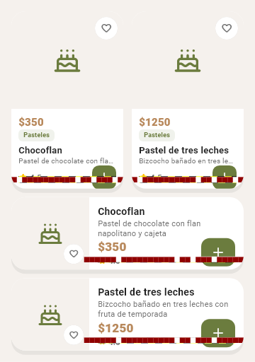
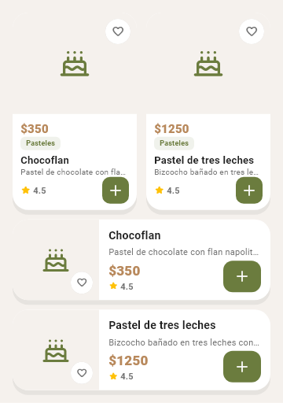
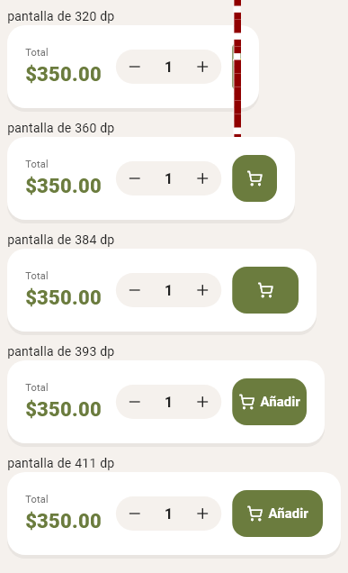
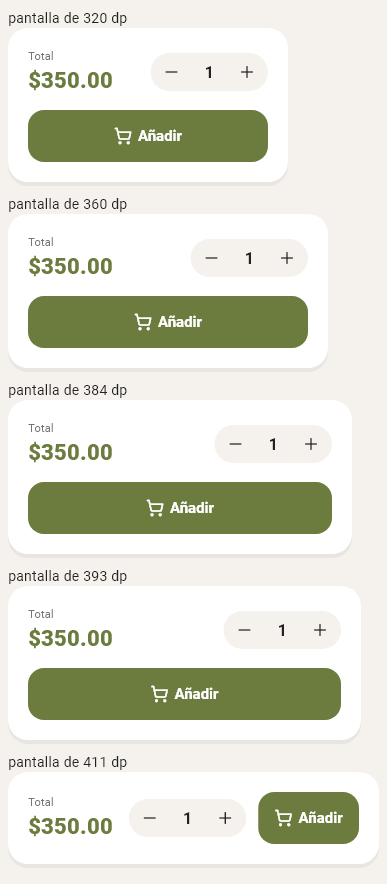

# Pruebas en dispositivo — Repartidor en segundo plano y fragmentación (#81)

Comprobamos dos cosas. La primera, que el módulo del repartidor funciona con el
teléfono en el bolsillo: la app en segundo plano, una llamada a media entrega y
la red que se va en la calle. La segunda, que la app se ve y funciona en
teléfonos distintos al Samsung del equipo: otras marcas, otros Android y, sobre
todo, pantallas más angostas. Cubre las historias #45 y #46 y complementa las
pruebas de #69.

> **En curso.** Están hechas las dos partes de fragmentación (secciones 4 y 5).
> Los tres escenarios del repartidor en el Samsung y el celular de Pedro están
> pendientes.

## Datos de la prueba

| Dato | Valor |
|---|---|
| Fecha | Sábado 21 de noviembre de 2026 (hora de México): Firebase Test Lab de 11:53 a 12:22; emuladores del pipeline de 13:19 a 14:39; Test Lab otra vez, con los arreglos, de 23:00 a 23:08 |
| App | La de `develop` (`b1ad8e5`), sabor `prod` en debug. Los emuladores corrieron además con los arreglos de #362 y #364. La repetición de Test Lab, con `develop` en `732e196`, que ya los trae |
| Servidor | Test Lab: ninguno, la prueba usa un servidor de mentira (`FakeApiClient`). Emuladores: el entorno aislado (la API y su base en contenedores, con datos ficticios) |
| Cómo se verificó | En debug, si algo no cabe en una pantalla Flutter lo reporta como error («A RenderFlex overflowed») y la prueba falla. Test Lab guarda además el video y el logcat de cada dispositivo |

## Resumen

| # | Escenario | Resultado |
|:-:|---|:-:|
| 1 | Repartidor disponible, 5 min en segundo plano y llega un pedido: al abrir aparece y se puede aceptar | ⏳ Pendiente |
| 2 | Confirmación de entrega con una llamada entrante a medio formulario: al colgar, el formulario sigue | ⏳ Pendiente |
| 3 | Aviso de llegada sin red: al volver la red se envía o hay un reintento claro | ⏳ Pendiente |
| 4 | Fragmentación local: los flujos de compra, reseña y entrega en emuladores de Android 10 (5") y Android 14 (6.7") | ✅ Pasó en los dos emuladores, con dos arreglos. Falta el celular de Pedro |
| 5 | Fragmentación en la nube: Firebase Test Lab en 3 modelos | ✅ Pasó en 2 físicos y 1 virtual; el virtual de 360 dp encontró dos fallas; 1 físico sin resultado. Con los arreglos pasa en el virtual de 360 dp y en un Galaxy S24 |

Se abrieron dos issues `bug`: #362 y #364. Los dos aparecen solo en pantallas
de menos de 393 dp de ancho; el Samsung mide 411.

## 4. Fragmentación local: emuladores de Android 10 y Android 14

Los tres flujos contra el entorno aislado corren ahora en dos celulares
virtuales en cada Pull Request (`integracion.yml`):

- compra hasta el checkout (#58),
- del catálogo a la reseña (#65),
- entrega a domicilio y reembolso (#69).

| Android | API | Perfil | Pantalla | Resultado |
|---|---|---|---|:-:|
| 10 | 29 | Nexus 5 | 5", 360 × 640 dp | ✅ 3 de 3 |
| 14 | 34 | Pixel 6 Pro | 6.7", 411 × 891 dp | ✅ 3 de 3 |

Para el de 5" se eligió el Nexus 5 porque mide 360 dp de ancho, como los Galaxy
S y muchos teléfonos de entrada. Los otros perfiles de 5" (Pixel, Pixel 2)
miden 411 dp, igual que el Samsung, y no habrían encontrado nada.

**Primera corrida.** En Android 14 pasaron los tres flujos. En Android 10 a
360 dp pasaron la reseña y la entrega, y falló la compra. Ya no había desbordes
en el catálogo y el botón «Añadir» tenía su texto (los arreglos de #362 y
#364), pero en esa pantalla el botón queda abajo de lo que se ve: la prueba se
desplazaba hasta él y lo tocaba sin esperar un cuadro, así que el toque iba a
donde el botón estaba antes, fuera de la pantalla. Era un defecto de la prueba,
no de la app. Ahora la prueba espera a que el botón se quede quieto antes de
tocarlo.

**Segunda corrida** (`8fd0212`): ✅ los tres flujos pasan en los dos emuladores.
La tabla de evidencias del pipeline muestra un renglón por Android.

No hay capturas por pantalla de los emuladores. Lo que se comprobó es que
ninguna pantalla de los tres recorridos se desborda: el inicio de sesión, el
Inicio, el catálogo, el detalle, el carrito, el checkout, «Mis Pedidos», las
reseñas, el panel del repartidor, la confirmación de entrega y «Mis
Reembolsos».

Falta repetir los flujos en el celular de Pedro.

## 5. Fragmentación en la nube: Firebase Test Lab

Se subieron los dos APK y una prueba de integración con el smoke y el flujo
principal juntos (`integration_test/test_lab_test.dart`, 3 casos): iniciar
sesión con credenciales inválidas, cargar el catálogo y el recorrido del inicio
de sesión al checkout. Proyecto `pier-reposteria-test-lab`, plan gratuito,
`locale=es_MX`, en vertical.

| Dispositivo | Tipo | Android (API) | Pantalla | Resultado |
|---|---|---|---|:-:|
| Medium Phone 6.4" (`MediumPhone.arm`) | Virtual | 14 (34) | 411 × 914 dp | ✅ 3 de 3 |
| Motorola G20 (`java`) | Físico | 11 (30) | 411 × 914 dp | ✅ 3 de 3 |
| Google Pixel 10 (`frankel`) | Físico | 16 (36) | 411 × 923 dp | ✅ 3 de 3 |
| Small Phone 4.65" (`SmallPhone.arm`) | Virtual | 10 (29) | 360 × 640 dp | ❌ 2 de 3: falla el flujo principal |
| Xiaomi 14 (`houji`) | Físico | 15 (35) | 400 × 890 dp | Sin resultado: la prueba no arrancó |

Los tres físicos se eligieron entre los que tenían más unidades libres ese día
y de marcas distintas a Samsung. Los del piloto de #75 (Galaxy A10, A15 y S24)
tenían pocas.

**Lo que encontró el teléfono de 360 dp.** El flujo principal falló por dos
motivos:

1. Dos tarjetas del catálogo desbordadas: `A RenderFlex overflowed by 9.1
   pixels on the bottom` en `producto_catalogo_card.dart`. La celda mide lo que
   le da el ancho de la pantalla y el texto ya no cabe. Es el **#362**.
2. La prueba esperó 90 s un botón con el texto «Añadir» en el detalle del
   producto y nunca apareció: en esa pantalla al botón le quedan 50 dp y sale
   solo con el ícono del carrito. Es el **#364**.

| Tarjetas del catálogo a 360 dp | Con el arreglo de #362 |
|:-:|:-:|
|  |  |

| Barra de compra del detalle, de 320 a 411 dp | Con el arreglo de #364 |
|:-:|:-:|
|  |  |

Las cuatro imágenes son las pantallas dibujadas en la laptop con las mismas
fuentes del teléfono; en modo debug el desborde se marca con la franja de
rayas.

El Motorola G20 y el Pixel 10 miden 411 dp de ancho, como el Samsung: por eso
pasaron y por eso estas dos fallas no se habían visto.

**El Xiaomi 14 no dio resultado.** HyperOS no deja que una prueba abra la app
desde segundo plano (`MIUILOG- Permission Denied Activity` y `Abort background
activity starts` en el logcat), así que la app nunca abrió y la corrida se
agotó a los 10 minutos. No dice nada de la app: quien toca el ícono no pasa por
ahí. Para las siguientes corridas no conviene elegir un Xiaomi.

**Cuota usada:** 3 de las 5 pruebas en físicos del día y 2 de las 10 en
virtuales. Costo: $0.

### Repetición con los arreglos

Con #362 y #364 ya en `develop`, la misma prueba se repitió esa noche en los
dos teléfonos de 360 dp de ancho: el virtual que había fallado y un Galaxy S24
físico (matriz `matrix-1yo1rc6yqh296`, APK de `develop` en `732e196`).

| Dispositivo | Tipo | Android (API) | Pantalla | Antes | Con los arreglos |
|---|---|---|---|:-:|:-:|
| Small Phone 4.65" (`SmallPhone.arm`) | Virtual | 10 (29) | 360 × 640 dp | ❌ 2 de 3 | ✅ 3 de 3 |
| Samsung Galaxy S24 (`e1q`) | Físico | 14 (34) | 360 × 780 dp | no se corrió | ✅ 3 de 3 |

El flujo principal ya llega al checkout en 360 dp: las tarjetas del catálogo
caben y el botón de compra del detalle dice «Añadir». La corrida tardó 8
minutos, 6 de ellos en la fila.

**Cuota del día con la repetición:** 4 de 5 pruebas en físicos y 3 de 10 en
virtuales. Costo: $0.

## Cómo repetir estas pruebas

Los emuladores corren solos en cada Pull Request (etapa de integración del
pipeline). Para Test Lab, los pasos están en [`tool/test_lab.md`](../tool/test_lab.md).
